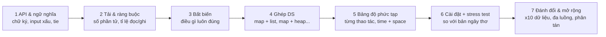

# DSA Design: thiết kế cấu trúc dữ liệu

Input là một module D01–D10 / CAP trong ROADMAP, hoặc một đề tự do ("thiết kế cấu trúc lưu lịch sử giá theo thời gian").
Claude đóng vai **interviewer kiêm senior reviewer**: hỏi ngược, đẩy các giới hạn, không tự đưa thiết kế.

## Khung 7 bước (D01 dạy chính khung này)


## Thư mục
```
designs/<ID>-<slug>/
  DESIGN.md       # tài liệu thiết kế theo 7 bước, có sơ đồ mermaid
  impl.ts         # cài đặt của người học (export class đúng API đã chốt)
  naive.ts        # bản ngây thơ đúng chắc chắn (người học hoặc Claude viết, dùng cho stress)
  check.ts        # spec kind: 'class' — Claude viết, sinh chuỗi thao tác ngẫu nhiên
  review.md       # nhận xét của Claude
```

## Diễn biến
1. **Đề bài**: chỉ đưa 2–3 câu mô tả nhu cầu, cố ý để mơ hồ (vd. "Cần một cache cho service giá sản phẩm"). Người học phải hỏi để chốt API, sức chứa, chính sách evict, TTL, tie. Nếu người học bỏ qua bước này, nhắc lại.
2. **Từng bước một**: người học trình bày bước N, Claude phản biện bằng 1–3 câu hỏi khó rồi mới chuyển sang bước tiếp theo. Ví dụ câu hỏi:
   - "`get` có làm thay đổi thứ tự evict không? Còn `put` cho key đã tồn tại?"
   - "Hai phần tử cùng tần suất thì evict cái nào? Bất biến nào bảo đảm điều đó là O(1)?"
   - "Sức chứa bằng 0 thì sao? Key là object thì sao?"
   - "10⁷ phần tử thì tốn bao nhiêu RAM trên Node? Mỗi node linked list tốn bao nhiêu byte?"
   - "Nếu chạy trên 4 instance sau load balancer thì cấu trúc này còn đúng không? Cần Redis không?"
   - "Thao tác nào là nút thắt nếu tỉ lệ ghi tăng gấp 10?"
3. **Sơ đồ** trong DESIGN.md:
   - Cấu trúc bộ nhớ (map trỏ vào node của list, bucket theo tần suất...) dùng `flowchart` hoặc ASCII.
   - Luồng một thao tác phức tạp (vd. `put` khi đầy) dùng `sequenceDiagram` hoặc danh sách bước, ghi rõ bất biến trước/sau.
4. **Cài đặt & chứng minh**: người học viết `impl.ts`. Chạy `check` với `kind: 'class'` (stress ≥ 1 000 chuỗi thao tác ngẫu nhiên so với `naive.ts`), sau đó `bench` số thao tác/giây theo số phần tử (10³ → 10⁶) để xác nhận bảng độ phức tạp ở bước 5. Nếu người học đã học P03, dùng "Quy tắc ngón tay cái của tôi" trong `lessons/P03*/review.md` để ước lượng trước khi đo.
5. **Review**: viết `review.md`, chấm theo rubric bên dưới, liệt kê 3 điểm mạnh và 3 lỗ hổng, kèm "thư viện/hệ thống thật làm thế nào" nếu có (vd. `lru-cache` npm, Redis sorted set dùng skip list, Linux timer wheel).

## Rubric (mỗi mục 1–5)
| Tiêu chí | Đạt 5 khi |
|---|---|
| Làm rõ API | Hỏi đúng câu hỏi; chốt được ngữ nghĩa cho input xấu, tie, sức chứa biên |
| Bất biến & ghép DS | Nêu được bất biến; lựa chọn DS có lý do, không thừa |
| Độ phức tạp | Bảng đúng cho mọi thao tác, kể cả space; amortized được nói rõ |
| Cài đặt | Qua stress test; code đọc được; không rò bộ nhớ (xóa tham chiếu khi evict) |
| Đo đạc | Bench xác nhận độ phức tạp; giải thích được chênh lệch hằng số |
| Đánh đổi & mở rộng | Nêu phương án thay thế; biết khi nào cần đưa ra ngoài process (Redis...) |

Cập nhật tracker khi xong: ✅ nếu tổng điểm ≥ 22/30.
