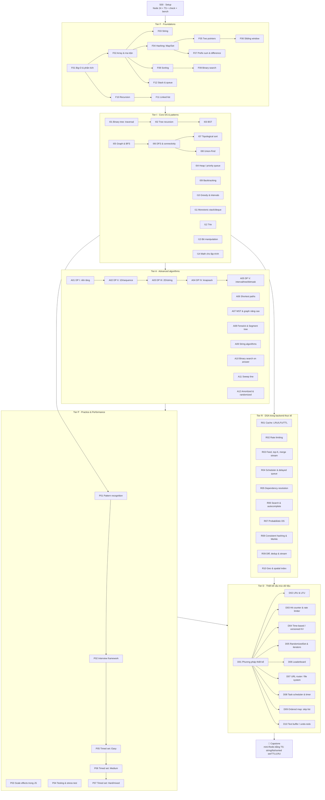
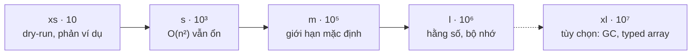
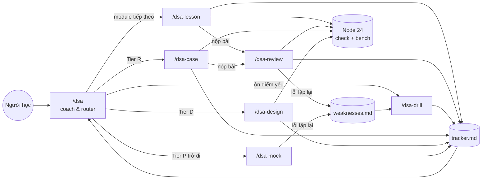
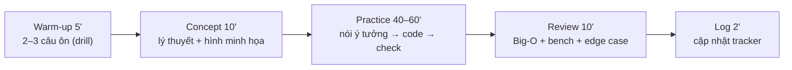
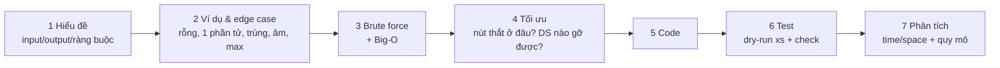

# Lộ trình DSA (TypeScript)

> Nguồn sự thật cho **module ID**. Các skill đọc file này để biết nội dung từng buổi.
> Mỗi module ≈ 1 buổi (60–90 phút). Module lớn có thể chia 2 buổi (`A02a`, `A02b`).
> Thứ tự đi: **S → F → I → A → P → R/D → CAP**. Tier F đi gần như tuần tự; từ Tier I có thể rẽ nhánh theo sơ đồ.

## Sơ đồ tổng thể

Ghi chú phụ thuộc chéo quan trọng:
`F11 + F04 → R01, D02` · `I04 → I10, A06, R03, R04, D06, D08` · `I07 → R05` · `I12 → R06, D07` · `F09 → A10` · `I08 → A07` · `A03 → R09` · `A12 → D09, R07` · `F01 + F10 → mọi phân tích độ phức tạp` · `P03 → R*, D*`

## Trục quy mô (xuyên suốt mọi tier)

Học DSA không dừng ở chỗ code ra kết quả đúng. Cần biết lời giải còn chạy được ở `n` bao nhiêu, và lý do.

| Tier | Quy mô được dùng | Cách luyện |
|---|---|---|
| F | `xs` / `s` / `m` | Tập trung vào đúng/sai và dry-run. Sau khi đúng, nêu Big-O; giới hạn thời gian ở `m` |
| I | `m` + `bench` | Mỗi lesson ≥1 câu hỏi quy mô: dự đoán Big-O + thời gian ở `l`, chạy `bench --scales s,m,l` |
| A | `m` / `l` | So sánh brute force → memo → tabulation → tối ưu bộ nhớ bằng số đo thật |
| P | `l` / `xl` | P03 chuyên về hằng số & bộ nhớ trong JS; các timed set có giới hạn thời gian như đề thật |
| R / D | `l` + ước lượng | Ước lượng QPS/bộ nhớ trên giấy, chứng minh bằng `bench`, nêu điểm gãy |

## Sơ đồ hệ thống skill

## Nhịp một buổi học chuẩn

## Khung giải một bài (áp dụng từ F01, bắt buộc nói ra từ Tier I)

---

## Danh mục module

Cột **Pass** = tiêu chí để đánh dấu ✅. Mặc định "8/10" nghĩa là: 8/10 bài qua `check` (cả cases, stress và perf), dùng ≤ 2 hint.

### S · Setup
| ID | Chủ đề | Nội dung chính | Pass |
|---|---|---|---|
| S00 | Môi trường | Hạ tầng đã dựng sẵn: Node ≥ 24 (bộ chấm), Python ≥ 3.10 / JDK 21 tùy ngôn ngữ chọn; `tools/` (check, bench, scaffold, runner Python/Java). Buổi này: chạy thử bộ chấm, chọn ngôn ngữ, tạo khung bài, làm 3 bài làm quen, bench `countPairs` bản O(n²) và O(n), cách debug trong từng ngôn ngữ | 3/3 bài qua `check`; `bench` cho số mũ ≈1 và ≈2 cho 2 bản |

### F · Foundations
| ID | Chủ đề | Nội dung chính | Pass |
|---|---|---|---|
| F01 | Big-O & phân tích | Đếm phép toán, O(1)/log n/n/n log n/n²/2ⁿ/n!, best/average/worst, space complexity (kể cả call stack), quy tắc ≈10⁸ phép/s, bảng ràng buộc → độ phức tạp, vòng lặp lồng nhau "trá hình" (`includes`, `indexOf`, `slice`, `shift` bên trong vòng lặp) | Phân loại đúng 8/10 đoạn code, kiểm chứng bằng `bench` |
| F02 | Array & ma trận | Dynamic array trong JS (`push` O(1) amortized, `shift`/`unshift`/`splice` O(n)), duyệt & chỉ số, reverse/rotate in-place, ma trận 2D (tạo đúng cách — bẫy `Array(n).fill([])`), duyệt xoắn ốc, transpose, xoay 90° | 8/10 |
| F03 | String | String bất biến trong JS, `+=` trong vòng lặp vs `array.join`, `charCodeAt`, đếm tần suất bằng mảng 26, palindrome, anagram, so sánh chuỗi, bẫy Unicode (emoji, `length`) | 8/10 |
| F04 | Hashing | `Map`/`Set` vs object thường (key bị ép string, `__proto__`), đếm tần suất, two-sum pattern, gom nhóm theo key, thiết kế key cho tuple (`${a},${b}`), hash collision & O(1) trung bình vs O(n) xấu nhất | 8/10 |
| F05 | Two pointers | Hai đầu ngược chiều (mảng đã sort, palindrome), cùng chiều fast/slow (xóa trùng in-place, gom phần tử), merge 2 mảng sorted, 3Sum (sort + two pointers, bỏ trùng) | 8/10 |
| F06 | Sliding window | Cửa sổ cố định, cửa sổ thay đổi (dài nhất/ngắn nhất thỏa điều kiện), cửa sổ + hash map đếm, bất biến của cửa sổ, vì sao O(n) dù có vòng `while` lồng | 8/10 |
| F07 | Prefix sum & difference | Prefix sum 1D/2D, tổng đoạn O(1), subarray sum = k (prefix + hash map), difference array cho cập nhật đoạn, prefix XOR/product | 8/10 |
| F08 | Sorting | Bubble/selection/insertion (hiểu, không dùng), merge sort, quick sort (partition, pivot, worst case O(n²)), counting sort, tính ổn định (stable), **bẫy `arr.sort()` mặc định so chuỗi**, comparator đúng, sort nhiều tiêu chí, sort làm bước tiền xử lý | 8/10 |
| F09 | Binary search | Template + bất biến vòng lặp, lower/upper bound, nửa mở `[lo, hi)`, mảng xoay, tìm đỉnh, tràn số `(lo+hi)>>1` vs `lo + ((hi-lo)>>1)`, giới thiệu binary search trên đáp án | 8/10 |
| F10 | Recursion | Call stack, base case, cây đệ quy, độ phức tạp đệ quy (T(n) = 2T(n/2) + n), **stack overflow trong JS (~10⁴ tầng)**, chuyển đệ quy sang vòng lặp + stack tự quản, memoization nhập môn | 8/10 |
| F11 | Linked list | Node & duyệt, reverse (vòng lặp + đệ quy), dummy head, fast/slow (giữa list, phát hiện chu trình Floyd), merge 2 list sorted, xóa phần tử thứ n từ cuối, doubly linked list | 8/10 |
| F12 | Stack & queue | Stack: ngoặc hợp lệ, RPN, min stack. Queue: **bẫy `shift()` O(n)** → queue bằng con trỏ đầu / ring buffer, deque, queue bằng 2 stack (amortized) | 8/10 |

### I · Core data structures & patterns
| ID | Chủ đề | Nội dung chính | Pass |
|---|---|---|---|
| I01 | Binary tree: traversal | Pre/in/post-order đệ quy & vòng lặp, level-order BFS, chiều cao/độ sâu, build cây từ mảng LeetCode, vẽ cây ASCII để debug | 8/10 |
| I02 | Tree recursion | Trả giá trị lên (diameter, balanced, max path sum), truyền trạng thái xuống (path sum), LCA, serialize/deserialize, build cây từ preorder + inorder | 8/10 |
| I03 | BST | Search/insert/delete, validate (bẫy chỉ so với con trực tiếp), inorder = sorted, kth smallest, successor, cây lệch → O(n), khái niệm cây cân bằng (AVL/Red-Black — chỉ khái niệm) | 8/10 |
| I04 | Heap / priority queue | **Tự cài binary heap bằng TS** (JS không có sẵn), sift up/down, heapify O(n), top-K, k-way merge, two heaps (median động), heap với comparator | Heap tự cài qua stress test + 6/8 |
| I05 | Graph & BFS | Adjacency list/matrix/edge list, grid như đồ thị, BFS đường đi ngắn nhất không trọng số, multi-source BFS, BFS theo tầng, khôi phục đường đi | 8/10 |
| I06 | DFS & connectivity | DFS đệ quy & vòng lặp, thành phần liên thông, flood fill, phát hiện chu trình (vô hướng; có hướng bằng 3 màu), đồ thị hai phía, clone graph | 8/10 |
| I07 | Topological sort | Kahn (in-degree) và DFS post-order, phát hiện chu trình, course schedule, thứ tự build, thứ tự từ điển người ngoài hành tinh | 6/8 |
| I08 | Union-Find (DSU) | Path compression + union by rank/size, α(n), đếm thành phần, cạnh thừa, gộp tài khoản, DSU trên grid | 6/8 |
| I09 | Backtracking | Khung choose → explore → unchoose, subsets, permutations, combinations (có/không trùng), cắt nhánh, N-Queens, word search, độ phức tạp hàm mũ | 8/10 |
| I10 | Greedy & intervals | Exchange argument, merge intervals, meeting rooms (sort + heap), non-overlapping intervals, jump game, gas station, **khi nào greedy sai** (tìm phản ví dụ) | 8/10 |
| I11 | Monotonic stack/deque | Next greater element, daily temperatures, largest rectangle in histogram, trapping rain water, sliding window maximum bằng deque, vì sao O(n) | 6/8 |
| I12 | Trie | Insert/search/startsWith, node bằng `Map` vs mảng 26, autocomplete, wildcard search (DFS trên trie), word search II, đánh đổi bộ nhớ | 6/8 |
| I13 | Bit manipulation | Biểu diễn nhị phân, `& \| ^ ~ << >>`, **JS bitwise ép về int32 có dấu, `>>>`**, single number, đếm bit 1, lũy thừa của 2, duyệt tập con bằng bitmask, `BigInt` khi cần > 32 bit | 8/10 |
| I14 | Math cho lập trình | gcd/lcm (Euclid), số nguyên tố & sàng Eratosthenes, lũy thừa nhanh, modulo 10⁹+7, **bẫy `Number.MAX_SAFE_INTEGER` (2⁵³) khi nhân modulo → `BigInt` hoặc nhân tách**, tổ hợp nCk, đếm cơ bản | 8/10 |

### A · Advanced algorithms
| ID | Chủ đề | Nội dung chính | Pass |
|---|---|---|---|
| A01 | DP I: nền tảng | Overlapping subproblems + optimal substructure, 4 bước: state → transition → base case → thứ tự tính, memo (top-down) vs tabulation (bottom-up), tối ưu bộ nhớ, Fibonacci/climbing stairs/house robber/min cost | 8/10, mỗi bài viết được cả memo lẫn tabulation |
| A02 | DP II: 1D & sequence | Coin change (min/số cách), LIS O(n²) và O(n log n), word break, decode ways, Kadane (max subarray), buy/sell stock (state machine) | 8/10 |
| A03 | DP III: 2D & string | Unique paths, min path sum, LCS, edit distance, longest palindromic subsequence/substring, khôi phục lời giải (truy vết) | 8/10 |
| A04 | DP IV: knapsack | 0/1 knapsack, unbounded, subset sum, partition equal subset, target sum, chiều duyệt khi nén 1D (ngược vs xuôi), đếm số cách vs tối ưu | 6/8 |
| A05 | DP V: interval, tree, bitmask | Interval DP (burst balloons, matrix chain), DP trên cây (house robber III, tree diameter), bitmask DP (TSP n ≤ 15), digit DP (giới thiệu) | 6/8 |
| A06 | Shortest paths | Dijkstra (heap tự cài, lazy deletion), 0-1 BFS, Bellman-Ford (cạnh âm, chu trình âm), Floyd-Warshall, chọn thuật toán theo ràng buộc, đường đi có trạng thái (≤ k điểm dừng) | 6/8 |
| A07 | MST & graph nâng cao | Kruskal (DSU), Prim (heap), cầu & khớp (Tarjan), SCC (Kosaraju/Tarjan), Euler path (giới thiệu) | 6/8 |
| A08 | Fenwick & Segment tree | Fenwick (BIT) cập nhật điểm/truy vấn prefix, đếm nghịch thế, segment tree truy vấn đoạn (sum/min/max), lazy propagation (khái niệm + 1 bài), so sánh với prefix sum | 6/8 |
| A09 | String algorithms | Prefix function (KMP), Z-function, rolling hash (Rabin-Karp) + bẫy va chạm & tràn số JS, chuỗi con lặp dài nhất, Manacher (tùy chọn) | 6/8 |
| A10 | Binary search on answer | Hàm kiểm tra đơn điệu, Koko ăn chuối, chia mảng tổng lớn nhất nhỏ nhất, ship trong D ngày, binary search số thực, kết hợp greedy check | 6/8 |
| A11 | Sweep line | Sắp sự kiện (start/end, tie-break), số phòng họp tối đa, skyline, khoảng thời gian rảnh chung, calendar booking | 6/8 |
| A12 | Amortized & randomized | Phân tích amortized (dynamic array, queue 2 stack, DSU), quickselect O(n) trung bình, reservoir sampling, shuffle Fisher-Yates, skip list (khái niệm + độ phức tạp kỳ vọng) | 6/8 |

### P · Practice & Performance
| ID | Chủ đề | Nội dung chính | Pass |
|---|---|---|---|
| P01 | Pattern recognition | Đọc ràng buộc + từ khóa → đoán pattern ("sorted" → binary search/two pointers, "subarray liên tiếp" → sliding window/prefix, "k lớn nhất" → heap, "số cách" → DP...). 20 đề, chỉ nêu hướng + Big-O, không code | Đúng hướng ≥ 16/20 |
| P02 | Interview framework | Hỏi lại đề, tự đưa ví dụ, nói brute force trước, tối ưu có lý do, code sạch, tự test bằng dry-run, phân tích độ phức tạp, **think aloud**. Luyện trên 3 bài với coach đóng vai interviewer | Rubric mock ≥ 3/4 mỗi trục |
| P03 | Scale effects trong JS | Thí nghiệm: hằng số ẩn trong Big-O; `number[]` vs `Int32Array`/`Float64Array`; array of objects vs struct-of-arrays; `Map` vs object vs mảng làm bảng đếm; tạo object trong vòng lặp nóng & GC; nối chuỗi; `sort` với comparator; đệ quy vs vòng lặp; mảng "holey" (`new Array(n)`) vs packed; bộ nhớ ở `n = 10⁷` | Mỗi thí nghiệm có dự đoán trước; đúng xu hướng ≥ 70%; viết được "Quy tắc ngón tay cái của tôi" |
| P04 | Testing & stress test | Tự liệt kê edge case, tự viết brute force + generator + so sánh, thu nhỏ phản ví dụ, assert bất biến, tìm bug trong code cho sẵn | Tìm được bug trong 6/8 đoạn code bằng stress test tự viết |
| P05 | Timed set: Easy | 6 bài trộn pattern, 15'/bài, không gợi ý trong giờ | ≥ 5/6 đúng trong giờ |
| P06 | Timed set: Medium | 5 bài trộn pattern, 25'/bài | ≥ 4/5 |
| P07 | Timed set: Hard/mixed | 4 bài, 40'/bài, có bài cần kết hợp 2 kỹ thuật | ≥ 2/4 |

### R · DSA trong backend thực tế
| ID | Chủ đề | Nội dung chính | Pass |
|---|---|---|---|
| R01 | Cache | LRU (Map giữ thứ tự chèn vs hash map + doubly linked list), LFU, TTL (lazy expire vs heap vs quét định kỳ), so với `lru-cache` của npm | Cache qua stress test + bench O(1)/thao tác |
| R02 | Rate limiting | Fixed window, sliding window log, sliding window counter, token bucket, leaky bucket — độ chính xác, bộ nhớ, burst. Cách Redis/NestJS throttler làm | Cài 3 thuật toán + so sánh bằng mô phỏng |
| R03 | Feed, top-K, merge stream | Merge k nguồn đã sort (heap), top-K trong stream không đủ RAM, phân trang bằng cursor trên feed gộp, top-K xấp xỉ | 6/8 |
| R04 | Scheduler & delayed queue | Job queue có độ ưu tiên + delay (heap), retry với backoff, timer wheel, tính lần chạy tiếp theo của cron, cách BullMQ dùng sorted set | Scheduler qua stress test |
| R05 | Dependency resolution | Topo sort cho thứ tự migration/build/module DI (NestJS), báo chu trình kèm đường đi, chạy song song theo tầng, semver resolution (giới thiệu) | 6/8 |
| R06 | Search & autocomplete | Trie + xếp hạng top-k gợi ý, inverted index, tìm kiếm mờ (edit distance có ngưỡng, BK-tree khái niệm), bỏ dấu tiếng Việt khi tìm | Autocomplete đạt perf ở 10⁵ từ |
| R07 | Probabilistic DS | Bloom filter (chọn m, k theo tỉ lệ false positive), HyperLogLog (khái niệm + bản đơn giản), count-min sketch — khi nào chấp nhận sai số | Đo tỉ lệ sai thực tế khớp lý thuyết |
| R08 | Consistent hashing & Merkle | Hash ring + virtual node, phân phối lại khi thêm/bớt node, rendezvous hashing, Merkle tree để đồng bộ/so sánh dữ liệu | Mô phỏng phân phối key + đo |
| R09 | Diff, dedup & stream | Diff 2 văn bản (LCS → Myers khái niệm), dedup trong stream (Set có giới hạn, Bloom), sliding window trên log theo thời gian, reservoir sampling cho log | 6/8 |
| R10 | Geo & spatial | Geohash, quadtree, tìm điểm gần nhất / trong bán kính ("tài xế gần tôi"), k-d tree (khái niệm), so với PostGIS | Truy vấn bán kính đạt perf ở 10⁵ điểm |

### D · Thiết kế cấu trúc dữ liệu
| ID | Chủ đề | Trọng tâm | Pass |
|---|---|---|---|
| D01 | Phương pháp | API (chữ ký + ngữ nghĩa) → bất biến → ghép DS cơ bản → bảng độ phức tạp từng thao tác → cài đặt → stress test với bản ngây thơ → đánh đổi | Áp dụng được checklist |
| D02 | LRU & LFU cache | O(1) mọi thao tác, xử lý tie trong LFU, sức chứa 0 | Bản thiết kế + stress test |
| D03 | Hit counter & rate limiter | Đếm theo cửa sổ thời gian, bộ nhớ có giới hạn, nhiều user | 〃 |
| D04 | Time-based / versioned KV | `set(k, v, t)`, `get(k, t)`, snapshot array, binary search trên lịch sử | 〃 |
| D05 | RandomizedSet & iterators | insert/delete/getRandom O(1), có trùng; iterator: flatten nested, peeking, zigzag | 〃 |
| D06 | Leaderboard | Cập nhật điểm + top-K + thứ hạng của 1 user; heap vs sorted structure vs bucket | 〃 |
| D07 | URL router / file system | Router kiểu Express/NestJS (`/users/:id/*`) bằng trie, ưu tiên static > param > wildcard; in-memory file system | 〃 |
| D08 | Task scheduler & timer | `schedule(fn, delay)`, hủy job, lặp lại, CPU task scheduler có cooldown | 〃 |
| D09 | Ordered map | JS không có TreeMap: tự cài skip list (hoặc treap) có `floor/ceiling/range`, so với mảng sorted + binary search | 〃 |
| D10 | Text buffer & undo/redo | Gap buffer / rope (khái niệm), undo/redo bằng 2 stack, command pattern, giới hạn lịch sử | 〃 |
| CAP | Capstone | mini-Redis bằng TS: `GET/SET/DEL/EXPIRE`, list (deque), sorted set (skip list + map), eviction LRU, TTL; test + bench + tài liệu thiết kế | Demo + review |
