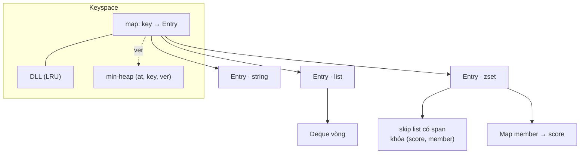
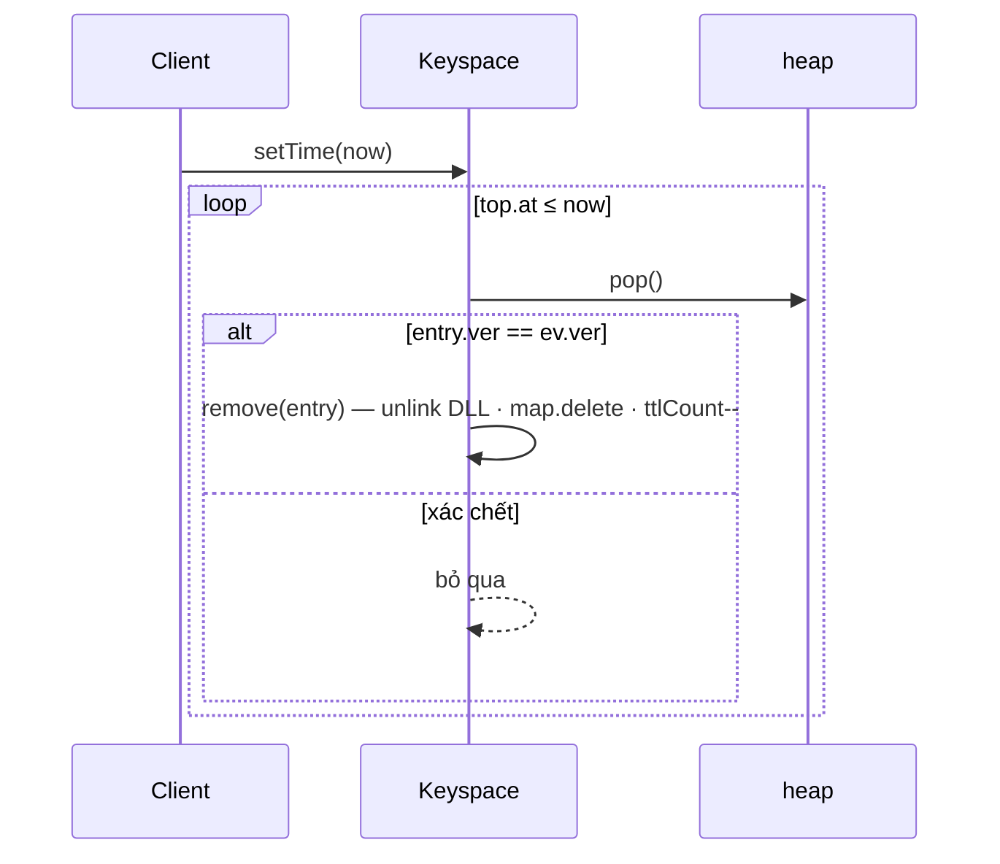
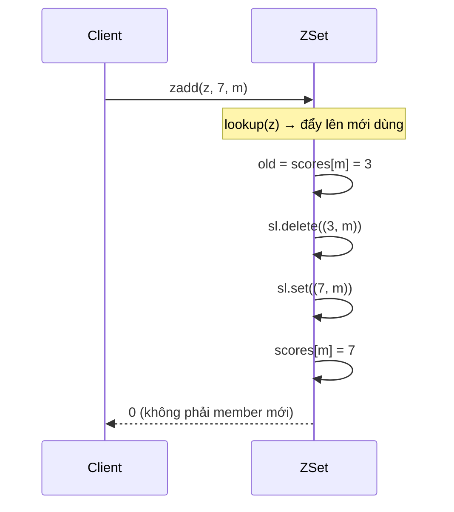

# DESIGN · mini-Redis (mẫu theo khung 7 bước)

> Đề mơ hồ: *"Cần một kho key-value trong bộ nhớ cho service: cache, hàng đợi đơn giản và bảng xếp hạng — dùng chung một giới hạn bộ nhớ."*

## 1. API & ngữ nghĩa
Xem `exercises.md` cho chữ ký. Những quyết định đã chốt (và lý do):

| Câu hỏi | Chốt | Vì sao |
|---|---|---|
| Đồng hồ | `setTime(now)` do caller đẩy, không giảm | test tất định; không phụ thuộc `Date.now()` |
| Key hết hạn khi nào? | ngay khi `now ≥ expireAt` (hết hạn *chủ động*) | `size`/sức chứa phải đúng mà không cần ai truy cập |
| Sức chứa | `maxKeys` key **sống**; tạo key mới khi đầy ⇒ evict LRU sống | gộp cả ba kiểu dưới một giới hạn |
| "Dùng" | mọi lệnh gặp key sống (kể cả sai kiểu), trừ `ttl/type/size` | quan sát không được làm đổi chính sách evict |
| Sai kiểu | không đổi dữ liệu, trả giá trị thất bại, vẫn "dùng" | giống Redis `WRONGTYPE` nhưng không ném lỗi (để test JSON) |
| `set` | ghi đè mọi kiểu, xóa TTL | như Redis `SET` |
| List/zset rỗng | key bị xóa | như Redis; trả lại chỗ, bỏ TTL |
| Thứ tự zset | `(score tăng, member tăng ASCII)` | thứ tự toàn phần, ba ngôn ngữ cùng kết quả |
| `lrange/zrange` | chỉ số kiểu Redis (âm = từ cuối, hai đầu gồm) | tương thích mong đợi |

## 2. Tải & ràng buộc
- `10⁵`–`10⁶` khóa; trộn đọc/ghi; đa số lệnh O(1) trên đường nóng; `setTime` được gọi định kỳ.
- list có thể dài (hàng đợi), zset có thể lớn (bảng xếp hạng); `lrange/zrange` lấy cửa sổ nhỏ.
- Mục tiêu: không lệnh nào quét toàn bộ keyspace.

## 3. Bất biến
**Keyspace**
1. `map.size ≤ maxKeys`; mọi `Entry` trong `map` đều sống (`expireAt > now`).
2. DLL gồm đúng các `Entry` trong `map`, từ mới dùng nhất (`head.next`) đến cũ nhất (`tail.prev`).
3. Mỗi `Entry` có TTL có đúng một sự kiện **hiệu lực** trong heap (`ev.ver === entry.ver`, `ev.at === entry.expireAt`); sự kiện khác là xác chết.
4. `ttlCount` = số `Entry` có TTL; `heap.size ≤ 2·ttlCount + 16` (dựng lại khi vượt).

**List** — `Deque` vòng: `size` phần tử liên tiếp tính từ `head` theo modulo; `buf.length` là lũy thừa 2; ô ngoài `[head, head+size)` là `undefined` (không giữ tham chiếu).

**Sorted set**
5. `scores` và skip list có **cùng tập member**; mỗi member đúng một khóa `(score hiện hành, member)` trong skip list.
6. Skip list có span (xem D09): rank = tổng span trên đường tìm.

**Liên thành phần**
7. Một `Entry` có đúng một kiểu; `list !== null ⇔ kind = 1`, `z !== null ⇔ kind = 2`.
8. Xóa key (hết hạn, evict, `delete`, tập rỗng) đi qua **một** hàm `remove` ⇒ DLL, map, `ttlCount` luôn đồng bộ.

## 4. Ghép cấu trúc

`setTime(now)`:

`zadd(z, 7, "m")` khi `m` đã có điểm 3:

| Phương án | Vì sao không / khi nào |
|---|---|
| Hết hạn lười (chỉ khi truy cập) | `size` sai, evict nhầm key sống; Redis thật bổ sung lấy mẫu chủ động |
| Quét mọi key mỗi `setTime` | O(n) mỗi lần |
| List bằng `Array` + `unshift`/`shift` | O(n) mỗi `lpush`/`lpop` |
| Sorted set bằng mảng sort | `zadd` O(n) |
| Sorted set bằng `Map` + sort mỗi `zrange` | O(n log n) mỗi truy vấn |
| **Skip list có span + Map** (chọn) | `zrank/zrange` O(log n), `zscore` O(1) |
| LRU xấp xỉ bằng lấy mẫu (Redis) | tiết kiệm 2 con trỏ/key; không tất định ⇒ khó test |

## 5. Bảng độ phức tạp
| Lệnh | Time | Ghi chú |
|---|---|---|
| `set`, `get`, `delete`, `ttl`, `type`, `size` | O(1) | `Map` + DLL |
| `expire` | O(log n) | đẩy heap; dựng lại O(n) khi heap > 2·ttlCount (amortized O(1)) |
| `setTime` | O(log n) / key hết hạn | |
| `lpush`, `rpush`, `lpop`, `rpop` | O(1) amortized | deque vòng nhân đôi khi đầy |
| `lrange` | O(k) | truy cập chỉ số O(1) |
| `zadd`, `zrem`, `zrank` | O(log n) kỳ vọng | skip list |
| `zrange` | O(log n + k) | nhảy tới `start` bằng span rồi đi dọc tầng 0 |
| `zscore` | O(1) | `Map` |
| Space | O(Σ phần tử) | mỗi `Entry` thêm hằng số (DLL, ver, expireAt) |

## 6. Cài đặt & stress test
- `solutions.ts`: `Deque`, `ZSet` (skip list D09), `Keyspace` (LRU + TTL + capacity), `MiniKV`, `MiniRedis extends MiniKV`.
- **Brute** (`NaiveRedis`): mảng khóa theo thứ tự LRU, mọi lệnh tìm bằng quét, zset sắp lại mỗi lần, `setTime` quét mọi key, chỉ số `lrange/zrange` viết lại bằng vòng lặp. Cài đặt **không chia sẻ** gì với solutions.
- **Stress:** 300 chuỗi lệnh ngẫu nhiên (`n ≤ 30`, `maxKeys` 1–3, 4 khóa dùng chung cho mọi kiểu ⇒ rất nhiều sai kiểu, evict, hết hạn đồng thời).
- **Case lớn không có `expected`:** chuỗi 900 lệnh (80 khóa, `maxKeys` 40: evict liên tục), 6 000 lệnh (30 000 khóa), một zset 3 000 member (skip list nhiều tầng), đặt lại TTL 60 lần (heap phải dựng lại).
- **Kiểm tra bằng đột biến (đã chạy, mỗi lần chỉ phá một chỗ):**

| Phá chỗ nào | Ai bắt |
|---|---|
| `zadd` không xóa khóa cũ khỏi skip list | case zset 3 000 member |
| `ttl()` gọi `lookup` (đụng LRU) | case "ttl không phải dùng" (ex01) và stress (ex02) |
| `set` không xóa TTL | case "set ghi đè xóa TTL cũ" |
| list rỗng không bị xóa | case "list rỗng bị xóa" |
| dựng lại heap gán `ver` sai | case đặt lại TTL 60 lần |

- **Port Python (độc lập, `bisect` cho zset) và Java (`MiniKV`)** đều qua toàn bộ case + stress: spec không phụ thuộc vào chi tiết cài đặt TS.
- Bản ngây thơ (chính brute) bị Perf bắt: 5 193 ms (ex01) và 3 655 ms (ex02) so với giới hạn hiệu lực 1 200/1 800 ms ở hệ số 3.
- `node tools/bench.ts lessons/CAP-mini-redis 0X --src solutions --scales s,m,l` (30 000 khóa, `maxKeys` 20 000):

| Bài | n | median | số mũ | heap |
|---|---|---|---|---|
| ex01 | 10³ | 0.20 ms | – | 0.4 MB |
| ex01 | 10⁵ | 18.0 ms | 0.97 | 7.6 MB |
| ex01 | 10⁶ | 325.9 ms | 1.26 | 64.0 MB |
| ex02 | 10³ | 0.37 ms | – | 0.6 MB |
| ex02 | 10⁵ | 28.9 ms | 0.95 | 18.1 MB |
| ex02 | 10⁶ | 370.3 ms | 1.11 | 76.2 MB |

Thời gian tăng gần tuyến tính theo số lệnh ⇒ chi phí mỗi lệnh gần hằng số/logarit đúng bảng bước 5.

## 7. Đánh đổi & mở rộng
- **×10 dữ liệu (10⁷ khóa):** `Entry` là object lớn (khóa chuỗi, 2 con trỏ DLL, `ver`, `expireAt`, các trường kiểu). Chuyển sang cấu trúc cột: typed array cho `prev/next/expireAt/ver`, bảng băm tự cài từ khóa sang chỉ số; list dùng quicklist (các đoạn nhỏ), zset nhỏ dùng listpack/mảng như Redis.
- **LRU xấp xỉ:** Redis lấy mẫu (mặc định 5 key), evict key cũ nhất trong mẫu ⇒ không cần DLL, nhưng không tất định; chấp nhận được ở quy mô lớn.
- **Hết hạn:** Redis kết hợp *lazy* (kiểm khi truy cập) và *active* (mỗi 100 ms lấy mẫu 20 key có TTL, lặp nếu > 25% hết hạn). Bản này hết hạn chính xác nhờ heap, đổi lại O(log n) cho mỗi `expire`.
- **Đa luồng:** mọi lệnh đều ghi (LRU) ⇒ Redis chạy lệnh đơn luồng để khỏi khóa. Mở rộng bằng sharding theo hash(key) (cluster slots).
- **Bền vững:** snapshot (RDB: fork + ghi bộ nhớ) và/hoặc log lệnh (AOF + fsync); khôi phục = phát lại. Hết hạn phải ghi dưới dạng lệnh `DEL` để replica nhất quán.
- **Nhiều instance:** replica bất đồng bộ, chuyển đổi dự phòng; cache lệch thời gian giữa các instance ⇒ dùng TTL ngắn hoặc invalidation.
- **Nút thắt khi ghi ×10:** cấp phát object `Entry`/`ZKey` và áp lực GC ⇒ pool đối tượng, `ZKey` nén thành một số khi member được băm thành id.
- **Hệ thống thật để so:** Redis (`dict` + `skiplist` + `quicklist` + approximated LRU), Memcached (slab + LRU theo slab), Caffeine (W-TinyLFU), Ehcache.
