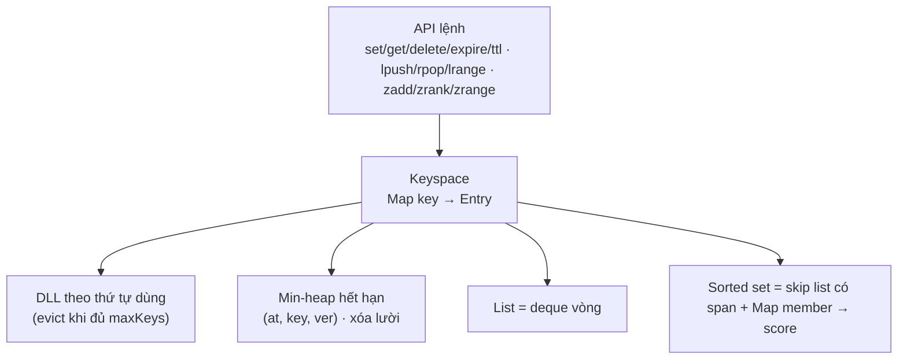

# CAP · Capstone: mini-Redis

## Sau buổi này bạn sẽ
- Ghép **mọi** cấu trúc đã học thành một hệ thống nhỏ nhưng hoàn chỉnh: hash map, danh sách liên kết đôi (LRU), heap (hết hạn), deque vòng (list), skip list có span (sorted set).
- Chốt **ngữ nghĩa** của một hệ thống nhiều lệnh: kiểu khóa, sai kiểu, TTL, sức chứa, thứ tự LRU, khi nào key "chết".
- Viết **stress test** so với bản ngây thơ và **bench** để xác nhận bảng độ phức tạp.
- Viết tài liệu thiết kế 7 bước cho một hệ thống nhiều thành phần.

Module này không dạy cấu trúc mới; nó kiểm tra bạn **ghép** được chúng. Đọc [`DESIGN.md`](./DESIGN.md) sau khi tự thiết kế bước 1–5.

## 1. Bản đồ thành phần

| Thành phần | Dùng ở | Bài đã học |
|---|---|---|
| Hash map + DLL | `Keyspace` + LRU | D02 |
| Min-heap + xóa lười + phiên bản | hết hạn TTL | D08 |
| Deque vòng (ring buffer) | list | F12 |
| Skip list + span | sorted set (`zrank`, `zrange`) | D09 |
| Mô-đun hóa "mỗi thao tác một cấu trúc" | cả hệ thống | D01 |

## 2. Hai bài, hai chặng

- **ex01 · MiniKV:** chuỗi + TTL + LRU + `maxKeys`. Chặng này quyết định hầu hết quy tắc khó: khi nào key hết hạn, cái gì tính là "dùng", hết hạn có giải phóng chỗ không.
- **ex02 · MiniRedis:** thêm **list** và **sorted set**, **kiểu khóa** và quy tắc sai kiểu. Nếu ex01 gọn, ex02 chủ yếu là thêm hai cấu trúc vào cùng `Keyspace`.

## 3. Quy tắc ngữ nghĩa quan trọng (đã chốt trong đề)

1. **Thời gian do caller đẩy:** `setTime(now)` (không giảm). Key hết hạn khi `now ≥ expireAt` và **biến mất ngay** tại `setTime`, kể cả khi chưa ai truy cập.
2. **Sức chứa:** số key sống ≤ `maxKeys`. Tạo key **mới** khi đã đầy ⇒ evict key sống dùng **lâu nhất**. Key hết hạn không chiếm chỗ.
3. **"Dùng"** = mọi lệnh gặp key đang sống (đọc hay ghi, đúng kiểu hay sai kiểu), **trừ** `ttl`, `type`, `size`.
4. **Sai kiểu:** không đổi dữ liệu, trả giá trị thất bại của lệnh đó (`-1`, `null`, `false`, `[]`) nhưng vẫn là một lần "dùng". `set` ghi đè mọi kiểu và xóa TTL.
5. **Tập rỗng:** list/zset hết phần tử thì key bị xóa (trả lại chỗ, mất TTL).

## 4. Dấu hiệu bạn đang làm đúng
- Mỗi thao tác chỉ đụng đúng cấu trúc của nó; không có chỗ nào quét toàn bộ key.
- Bạn nói được bất biến giữa `Map` và DLL, giữa `Map member → score` và skip list, giữa `Entry.ver` và sự kiện trong heap.
- `bench` cho thấy thời gian tăng gần tuyến tính theo số lệnh.

## 5. Theo ngôn ngữ

| | TS | Python | Java |
|---|---|---|---|
| LRU | DLL tự cài | `OrderedDict.move_to_end` | `LinkedHashMap(…, accessOrder = true)` — chú ý: `get` cũng đổi thứ tự, **kể cả `ttl`**, nên cần tự quản lý nếu đề không muốn |
| Hết hạn | heap tự cài | `heapq` | `PriorityQueue` |
| List hai đầu + truy cập chỉ số | ring buffer tự cài | `deque` (chỉ số giữa O(n)) hoặc ring buffer | `ArrayDeque` (không có `get(i)`) → tự cài |
| Sorted set có rank | skip list có span | `bisect.insort` trên list (chèn O(n)) hoặc tự cài | không có sẵn: `TreeSet` không cho rank O(log n) → tự cài |

Thời gian ms kiểu `long` (Java); `score` của zset kiểu `long`.

## 6. Bẫy
1. Hết hạn lười (chỉ kiểm khi truy cập) ⇒ `size` sai và evict nhầm key sống khi vẫn còn key hết hạn.
2. `ttl()` đẩy key lên mới dùng (Java `LinkedHashMap` access-order dễ dính).
3. Đặt lại TTL / `set` ghi đè mà heap vẫn giữ sự kiện cũ ⇒ key bị xóa nhầm (thiếu phiên bản) hoặc heap phình (thiếu dựng lại).
4. `zadd` cùng member khác điểm ⇒ phải xóa khóa cũ khỏi skip list.
5. Quên xóa key khi list/zset rỗng.
6. Chỉ số âm của `lrange/zrange`.
7. Quên dùng chung một `Keyspace`: mỗi kiểu một bảng riêng ⇒ không áp được sức chứa/LRU/TTL thống nhất.

## 7. Độ phức tạp
| Thao tác | Thời gian |
|---|---|
| `set/get/delete/ttl/type/size` | O(1) |
| `expire` | O(log n) (đẩy heap) |
| `setTime` | O(log n) mỗi key hết hạn (amortized) |
| `lpush/rpush/lpop/rpop` | O(1) amortized |
| `lrange` | O(k) |
| `zadd/zrem/zrank` | O(log n) kỳ vọng |
| `zrange` | O(log n + k) |
| `zscore` | O(1) |

🧭 Câu hỏi quy mô: với `10⁶` khóa và `10⁶` lệnh, mỗi `Entry` (object + 2 con trỏ DLL + khóa chuỗi) tốn khoảng bao nhiêu byte trên V8? Dự đoán `heap MB`, rồi `bench` ở scale `l` và so sánh.
