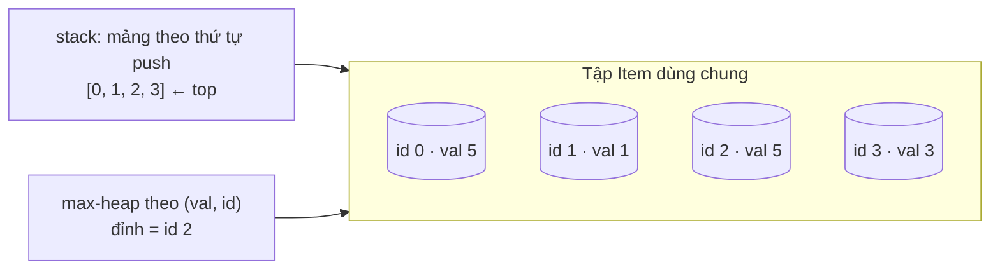

# DESIGN · MaxStack (mẫu theo khung 7 bước)

> Tài liệu mẫu. Đề cố ý mơ hồ như trong phỏng vấn: *"Cần một stack mà lúc nào cũng hỏi được phần tử lớn nhất, và lấy được phần tử lớn nhất ra."*
> Các module D02–D10 và CAP có `DESIGN.md` cùng khuôn; hãy đọc các bước **1–3 trước khi nhìn vào bước 4**.

## 1. API & ngữ nghĩa
Câu hỏi đã hỏi ngược lại người ra đề, và câu trả lời đã chốt:

| Câu hỏi | Chốt |
|---|---|
| `popMax` khi có nhiều phần tử lớn nhất bằng nhau? | Xóa cái **gần đỉnh nhất** (đẩy sau cùng) |
| Gọi `pop/top/peekMax/popMax` khi rỗng? | Không xảy ra (tiền điều kiện); không cần xử lý |
| Giá trị? | `int` 32-bit, có thể âm, có thể trùng |
| `peekMax` / `top` có đổi trạng thái? | Không |

```ts
class MaxStack { push(x): void; pop(): number; top(): number; peekMax(): number; popMax(): number }
```

## 2. Tải & ràng buộc
- Tối đa `10⁵` thao tác (mục tiêu mở rộng: `10⁶`), kích thước stack tới `10⁵`–`10⁶`.
- Tỉ lệ chưa rõ → thiết kế để **không thao tác nào** là nút thắt: mục tiêu mỗi thao tác ≤ O(log n) (amortized chấp nhận được).
- Bản quét tuyến tính `popMax` ở `n = 10⁵` cho ~`10⁹` phép → loại.

## 3. Bất biến
1. Tập **Item sống** là đúng nội dung của stack: mỗi Item sống nằm **đúng một lần** trong `stack` và **đúng một lần** trong `heap`.
2. Item `dead` có thể còn nằm ở một trong hai cấu trúc, nhưng **không bao giờ** nằm ở đỉnh khi ta đọc đỉnh (luôn `trim` trước khi đọc).
3. Thứ tự trong `heap`: `(val, id)` lớn hơn → ở trên. `id` tăng theo thứ tự push ⇒ hòa giá trị thì Item đẩy sau cùng thắng (đúng quy tắc "gần đỉnh nhất").
4. Số Item chết không vượt quá số Item sống (+ hằng số nhỏ) ⇒ bộ nhớ O(số phần tử sống).

## 4. Ghép cấu trúc dữ liệu

- `pop` lấy đỉnh `stack`, **đánh dấu dead**; `heap` chưa biết ⇒ lần sau `peekMax` sẽ vứt nó khi nó nổi lên.
- `popMax` lấy đỉnh `heap`, đánh dấu dead; `stack` vứt nó khi nó lộ ra ở đỉnh.
- Khi `dead > sống + 16` ⇒ `compact()`: lọc `stack`, heapify lại.

Phương án đã cân nhắc:
| Phương án | Vì sao không chọn |
|---|---|
| Quét tuyến tính tìm max | `popMax` O(n) |
| Stack kèm "max tính đến đây" (như Min stack) | `popMax` phải xóa *giữa* stack → phá bất biến "max tính đến đây" của phần tử phía trên |
| DLL + TreeMap<val, danh sách node> | O(log n) không cần xóa lười, nhưng TS không có TreeMap → phải tự cài cây/skip list (xem D09) |
| **Mảng + max-heap + xóa lười** | Chọn: ít code, tái dùng `Heap` |

## 5. Bảng độ phức tạp
| Thao tác | Time | Ghi chú |
|---|---|---|
| `push` | O(log n) | đẩy vào heap |
| `top` | O(1) amortized | `trimStack` vứt xác chết, mỗi Item bị vứt ≤ 1 lần |
| `pop` | O(1) amortized | |
| `peekMax` | O(log n) amortized | `trimHeap` pop xác chết |
| `popMax` | O(log n) amortized | |
| `compact` | O(n) | chạy sau ≥ n/2 lần xóa ⇒ O(1) amortized/thao tác |
| Space | O(n) | n = số Item sống (nhờ `compact`) |

## 6. Cài đặt & stress test
- Cài đặt: `solutions.ts` (`MaxStack`), `Heap` lấy từ I04.
- Bản ngây thơ cho stress: mảng thuần, `Math.max` + `splice` (đúng hiển nhiên, O(n)).
- Chạy: `DSA_PERF_FACTOR=3 node tools/check.ts lessons/D01-design-method 01 --src solutions`
- Đo: `node tools/bench.ts lessons/D01-design-method 01 --src solutions --scales s,m,l` cho (đo trên máy chạy kiểm chứng, TS/Node 24):

| n | thời gian median | số mũ ước lượng |
|---|---|---|
| 10³ | 0.28 ms | – |
| 10⁵ | 48.9 ms | 1.13 |
| 10⁶ | 509 ms | 1.02 |

Số mũ ≈ 1.0–1.1 ⇒ khớp bảng O(log n) mỗi thao tác (tổng O(n log n)); bản quét tuyến tính sẽ có số mũ ≈ 2.

## 7. Đánh đổi & mở rộng
- **×10 dữ liệu:** mỗi Item là một object (≈ vài chục byte) ⇒ 10⁷ Item tốn hàng trăm MB. Cách giảm: lưu `val` và `id` trong typed array, heap lưu chỉ số.
- **Đa luồng/đa tiến trình:** cấu trúc này không thread-safe; trong Node chỉ có một luồng JS nên đủ dùng, trên JVM cần khóa hoặc `ConcurrentSkipListMap`.
- **Nhiều instance:** state nằm trong tiến trình ⇒ mất khi restart; cần đưa ra ngoài (Redis sorted set) nếu stack phải chia sẻ.
- **Thao tác nào là nút thắt khi ghi tăng ×10?** `push` (O(log n) heap). Nếu `popMax` hiếm, có thể bỏ heap và quét khi cần (đổi trade-off theo tải).
- **Thư viện thật:** Java dùng `TreeMap` + DLL cho cùng bài; Redis `ZSET` (skip list) cho "lấy phần tử max theo score".
