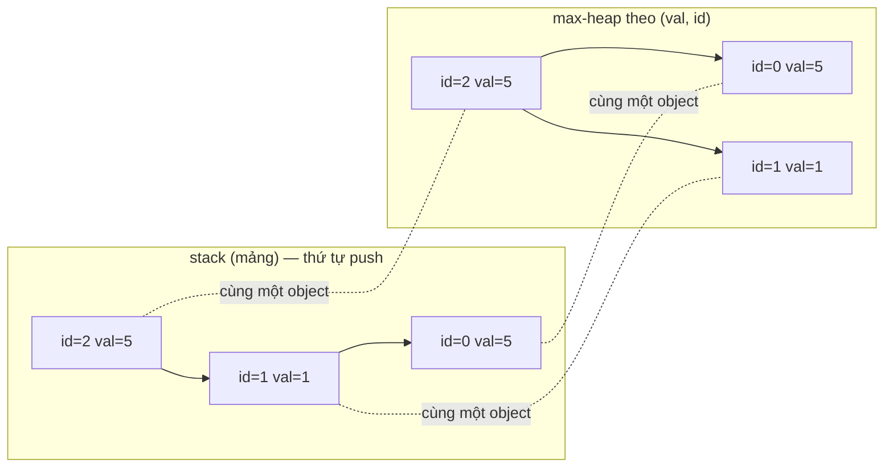
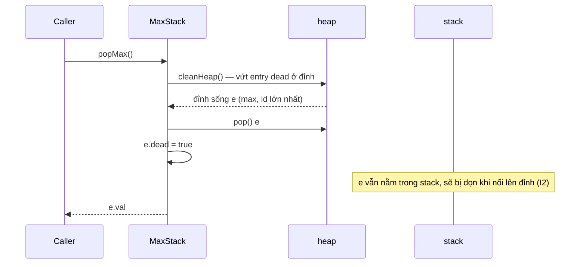

# DESIGN · MaxStack (mẫu đầy đủ theo khung 7 bước)

> Đề (cố ý mơ hồ): *"Cần một stack hỗ trợ lấy và xóa phần tử lớn nhất."*
> Tài liệu này là **ví dụ** để bạn bắt chước cho các module D02–D10 và CAP: mỗi bước có (a) quyết định, (b) câu hỏi phản biện, (c) sản phẩm.

---

## Bước 1 · API & ngữ nghĩa

Câu hỏi làm rõ (nên hỏi interviewer):

| Câu hỏi | Chốt |
|---|---|
| Có những thao tác nào? | `push(x)`, `pop()`, `top()`, `peekMax()`, `popMax()` |
| Kiểu phần tử? | số nguyên, `|x| ≤ 10⁹` (vừa `int`) |
| `pop/top/...` trên stack rỗng? | Không bao giờ xảy ra (caller bảo đảm). Thư viện thật nên ném lỗi — ghi vào "mở rộng" |
| Trùng giá trị lớn nhất, `popMax` xóa cái nào? | Cái **nằm trên cùng** (push sau cùng) |
| `pop`/`popMax` trả gì? | Giá trị bị xóa |
| Đa luồng? | Không (đơn luồng, như JS) |

```ts
class MaxStack {
  push(x: number): void;
  pop(): number;       // xóa & trả phần tử trên cùng
  top(): number;       // xem phần tử trên cùng
  peekMax(): number;   // xem giá trị lớn nhất
  popMax(): number;    // xóa & trả giá trị lớn nhất (cái trên cùng nếu trùng)
}
```

**Phản biện:** "`popMax` xóa phần tử ở *giữa* stack — sau đó `top()` của stack có còn đúng không?" → Có, vì chỉ phần tử bị xóa biến mất, thứ tự tương đối của phần còn lại giữ nguyên.

## Bước 2 · Tải & ràng buộc

- Tối đa `n = 10⁵` thao tác (mô hình LeetCode); mục tiêu mở rộng: `10⁶`.
- Giả định tỉ lệ: ghi (`push`) ≈ đọc/xóa. Không thao tác nào được phép O(n) → với `n = 10⁵`, O(n) mỗi thao tác là `10¹⁰` phép: quá giờ (đo thật: bản mảng ngây thơ mất ≈ 600 ms ở 10⁵ thao tác, bản tối ưu ≈ 16 ms — xem Bước 6).
- Thao tác khó: `popMax` (phải tìm max rồi xóa giữa stack) và `peekMax`.

## Bước 3 · Bất biến

Gọi mỗi lần `push` tạo ra một **entry** `{val, id, dead}`, `id` tăng dần.

1. **(I1)** Mỗi entry sống nằm đúng một lần trong `stack` (theo thứ tự `id` tăng dần từ đáy lên đỉnh) **và** đúng một lần trong `heap`.
2. **(I2)** Entry `dead` đã bị "xóa về mặt logic" nhưng có thể còn nằm ở bên chưa dọn. Đây là *toàn bộ* dấu vết của xóa lười.
3. **(I3)** Sau khi dọn đỉnh (`cleanStack` / `cleanHeap`), đỉnh của cấu trúc đó là entry **sống** hoặc cấu trúc rỗng. Mọi thao tác đọc đều dọn trước khi đọc.
4. **(I4)** Thứ tự heap: `(val, id)` lớn hơn thì ở trên → đỉnh heap = giá trị lớn nhất, hòa thì `id` lớn nhất (trên cùng của stack). Đó chính là ngữ nghĩa tie ở Bước 1.

Số entry sống = số phần tử logic của stack.

## Bước 4 · Ghép DS



Phương án đã cân nhắc:

| Phương án | Ưu | Nhược |
|---|---|---|
| Mảng, quét tìm max | Đơn giản, đúng chắc chắn → dùng làm **oracle** cho stress | `peekMax`, `popMax` O(n) |
| Stack + stack-of-max | `peekMax` O(1) | `popMax` vẫn phải đào xuống: O(n) |
| **Stack + heap + lazy deletion** (chọn) | Mọi thao tác O(log n) amortized, dùng heap có sẵn (I04) | Entry chết ở lại tới khi nổi lên → bộ nhớ có thể phình |
| DLL + cây cân bằng (TreeMap) | O(log n) *worst-case*, không phình | JS không có TreeMap; tốn công cài (xem D09) |

**Phản biện:** "Tại sao không xóa thật khỏi heap?" → Cần biết vị trí của entry trong heap để xóa ở giữa: phải lưu chỉ số và cập nhật khi swap (indexed heap). Phức tạp hơn mà không đổi Big-O.

Luồng `popMax()`:



## Bước 5 · Bảng độ phức tạp

| Thao tác | Time | Ghi chú | Space |
|---|---|---|---|
| `push` | O(log n) | push vào heap; push vào mảng O(1)* | +1 entry |
| `pop` | O(log n) amortized | dọn `dead` ở đỉnh stack (mỗi entry ≤ 1 lần); đánh dấu dead — **không** động vào heap | – |
| `top` | O(1) amortized | dọn `dead` ở đỉnh stack | – |
| `peekMax` | O(log n) amortized | dọn `dead` ở đỉnh heap (mỗi lần `heap.pop` là O(log n)) | – |
| `popMax` | O(log n) amortized | `heap.pop` + đánh dấu dead | – |
| Tổng | n thao tác → O(n log n) | Mỗi entry bị dọn tối đa 1 lần ở mỗi bên: tổng dọn ≤ 2n | **O(n)** |

\* amortized vì mảng động. *Worst-case* của một lần gọi có thể là O(n log n) (dọn cả đống entry chết) — nếu cần worst-case chặt (hệ thời gian thực) thì dùng phương án cây cân bằng.

## Bước 6 · Cài đặt & stress test

- Cài đặt: [`solutions.ts`](./solutions.ts) (spoiler với người học — bạn tự viết `impl`).
- **Oracle:** `brute` trong [`checks.ts`](./checks.ts) — mảng + `Math.max` + `lastIndexOf` + `splice`.
- **Stress:** 300 chuỗi thao tác ngẫu nhiên (≤ 60 thao tác, giá trị nhỏ `|x| ≤ 6` để *ép nhiều tie*) so từng giá trị trả về với oracle.
- **Đo:** `node tools/bench.ts lessons/D01-design-method 01 --src solutions --scales s,m,l`

| n (thao tác) | thời gian (median) | heap (≈) |
|---|---|---|
| 10³ | 0.5 ms | 0.9 MB |
| 10⁵ | 16 ms | 6.8 MB |
| 10⁶ | 364 ms | 69 MB |

Số mũ ước lượng 10⁵ → 10⁶ là ≈ 1.36 (> 1.1): ngoài `log n`, còn cache miss và GC khi dữ liệu không còn vừa cache. Bản ngây thơ ở 10⁵ thao tác (cùng chuỗi ngẫu nhiên): ≈ 600 ms — đã gấp ~40 lần, và sẽ tệ hơn bậc hai khi n tăng.

## Bước 7 · Đánh đổi & mở rộng

| Câu hỏi | Trả lời |
|---|---|
| 10× dữ liệu (10⁶ thao tác)? | ≈ 364 ms, ≈ 69 MB — vẫn ổn trong một process |
| 10⁷ entry sống? | ≈ 700 MB theo tỉ lệ trên → cân nhắc `Float64Array`/`Int32Array` cho `val` và heap theo chỉ số (cấu trúc theo cột thay vì mảng object) |
| Bộ nhớ phình do entry chết? | Chuỗi `push` rồi `pop` mãi mà không `peekMax`: heap giữ toàn bộ entry chết. Sửa: đếm `deadInHeap`; khi `deadInHeap > sống` thì dựng lại heap từ entry sống (O(n), amortized O(1) mỗi thao tác) |
| Thao tác nào là nút thắt khi tỉ lệ ghi ×10? | `push` (log n cho heap). Có thể trì hoãn: chỉ đẩy vào heap khi cần `peekMax/popMax` lần đầu (lazy build) |
| Đa luồng / nhiều instance? | Cần khóa quanh mọi thao tác vì `dead` dùng chung; nhiều instance → state ở một nơi (Redis `ZSET` cho phần max + `LIST` cho phần stack, thao tác ghép phải trong `MULTI`/Lua) |
| Thư viện thật? | Java: `TreeMap<Integer, List<Node>>` + `LinkedList`; Redis: sorted set (skip list) cho thứ tự theo giá trị. |
| Bản này sai ở đâu nếu đề đổi? | Nếu `popMax` phải xóa cái **dưới cùng** khi trùng: đổi comparator `id` ngược lại — chỉ một dòng. Nếu thêm `remove(x)` bất kỳ: vẫn dùng dead flag, nhưng cần `Map<value, entry[]>` để tìm entry |

---

### Checklist rút gọn (copy cho module sau)

- [ ] 1 API: chữ ký, input xấu, tie, trên rỗng
- [ ] 2 Tải: n, tỉ lệ đọc/ghi, thao tác nào phải nhanh
- [ ] 3 Bất biến: 2–4 câu "luôn đúng"
- [ ] 4 Ghép DS: sơ đồ + phương án đã loại và lý do
- [ ] 5 Bảng độ phức tạp (time + space, amortized ghi rõ)
- [ ] 6 Oracle ngây thơ + stress + bench
- [ ] 7 x10, phình bộ nhớ, đa luồng, hệ thống thật
