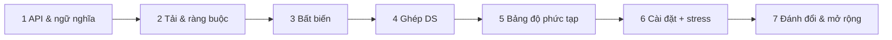

# D01 · Phương pháp thiết kế cấu trúc dữ liệu

## Sau buổi này bạn sẽ
- Có một **checklist 7 bước** để thiết kế bất kỳ cấu trúc dữ liệu nào, từ đề bài mơ hồ đến code đã stress test.
- Biết cách **ghép** các DS cơ bản (map + list, map + heap, stack + heap) và giữ chúng **đồng bộ** bằng bất biến.
- Dùng **lazy deletion** để tránh xóa phần tử ở giữa heap.
- Viết bảng độ phức tạp từng thao tác (kể cả amortized và space) *trước* khi code.

## 1. Khung 7 bước



| Bước | Câu hỏi cốt lõi | Sản phẩm |
|---|---|---|
| 1 API | Chữ ký? Input xấu (rỗng, trùng, ngoài miền) làm gì? Tie xử lý ra sao? | Danh sách method + ngữ nghĩa từng trường hợp biên |
| 2 Tải | Bao nhiêu phần tử? Thao tác nào chiếm đa số (đọc/ghi)? | Con số `n`, tỉ lệ thao tác → thao tác nào *phải* nhanh |
| 3 Bất biến | Điều gì luôn đúng giữa hai lần gọi? | 2–4 câu "luôn đúng", dùng để chứng minh và để viết assert |
| 4 Ghép DS | DS nào cho mỗi thao tác khó? Ghép lại thế nào? | Sơ đồ bộ nhớ |
| 5 Độ phức tạp | Mỗi thao tác bao nhiêu time/space? Amortized hay worst-case? | Bảng |
| 6 Cài đặt + stress | Có khớp bản ngây thơ không? Có đúng Big-O khi đo không? | `impl`, `naive`, stress, bench |
| 7 Đánh đổi | x10 dữ liệu? Đa luồng? Nhiều instance? | Phương án thay thế + khi nào đưa ra ngoài process |

Ví dụ trọn vẹn cho MaxStack: xem [`DESIGN.md`](./DESIGN.md) trong thư mục này (đọc sau khi đã thử tự làm bước 1–5).

## 2. Ghép DS: bảng gợi ý

| Cần | Ghép |
|---|---|
| Truy cập theo key **và** thứ tự dùng gần nhất | `Map` + danh sách liên kết đôi (LRU, D02) |
| Truy cập theo key **và** lấy max/min | `Map` + heap (lazy deletion), hoặc cây sắp xếp |
| Hai thứ tự cùng lúc (theo thời gian push **và** theo giá trị) | stack + heap dùng chung entry (MaxStack) |
| Nhóm theo tần suất, tie theo thời gian | `Map` đếm + mảng các stack/bucket (FreqStack) |
| Lấy ngẫu nhiên O(1) | mảng + map giá trị → vị trí (D05) |

## 3. Lazy deletion (xóa lười)
Heap chuẩn không xóa phần tử ở giữa rẻ. Thay vào đó: **đánh dấu** entry là `dead`, và chỉ vứt khi nó nổi lên đỉnh.

```ts
interface Entry { val: number; id: number; dead: boolean }
// xóa: e.dead = true;  đọc đỉnh: while (heap.peek().dead) heap.pop();
```
- Mỗi entry bị dọn tối đa một lần → tổng chi phí dọn ≤ số entry đã tạo → **amortized** O(log n) mỗi thao tác.
- Điều kiện: cùng một đối tượng entry phải nằm ở mọi cấu trúc (nên cờ `dead` dùng chung).
- Bộ nhớ: entry chết nằm lại cho tới khi nổi lên; chuỗi `push` rồi `pop` mãi (không bao giờ đọc heap) làm heap phình → xem phần đánh đổi trong DESIGN.md.

## 4. Theo ngôn ngữ

| | TS | Python | Java |
|---|---|---|---|
| Heap | tự cài (`Heap` ở I04) | `heapq` (min-heap, đẩy `-val`) | `PriorityQueue` + comparator |
| Map có thứ tự | không có | không có (`sortedcontainers` ngoài chuẩn) | `TreeMap` (floor/ceiling/…) |
| Danh sách liên kết đôi | tự cài | tự cài / `deque` | `LinkedList` / `LinkedHashMap` |
| Entry dùng chung | object | object / list | class nhỏ hoặc `int[]` |

## 5. Bẫy
1. Chốt API quá muộn (hỏi `pop` trên rỗng làm gì? → trong đề này luôn hợp lệ, nhưng phải *nói ra*).
2. Hai cấu trúc lệch nhau sau một thao tác xóa → bug khó tái hiện; stress test với chuỗi thao tác ngẫu nhiên mới bắt được.
3. Tie: "giá trị lớn nhất, nếu trùng thì cái nằm trên cùng" — thiếu `id` trong comparator là lỗi kinh điển.
4. Amortized ≠ worst-case: một lần gọi có thể dọn nhiều entry. Nói rõ trong bảng.
5. Tối ưu sớm: chạy bản ngây thơ trước, giữ nó làm oracle cho stress test.

## 6. Độ phức tạp các ví dụ

| | push | pop | top | peekMax | popMax | Space |
|---|---|---|---|---|---|---|
| MaxStack ngây thơ (mảng) | O(1) | O(1) | O(1) | O(n) | O(n) | O(n) |
| MaxStack stack + heap lazy | O(log n) | O(log n) am. | O(1) am. | O(log n) am. | O(log n) am. | O(n) |
| FreqStack | O(1) | O(1) | – | – | – | O(n) |
