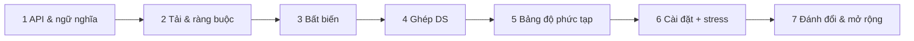

# D01 · Phương pháp thiết kế cấu trúc dữ liệu

## Sau buổi này bạn sẽ
- Đi qua **khung 7 bước** để biến một yêu cầu mơ hồ ("cần một cache…") thành thiết kế có thể cài và chứng minh được.
- Chọn cách **ghép** các cấu trúc cơ bản (map + list, map + heap, hai stack…) từ **bảng độ phức tạp mục tiêu**, thay vì đoán.
- Dùng **xóa lười (lazy deletion)** và **bảng độ phức tạp từng thao tác** như công cụ chính.
- Kiểm chứng thiết kế bằng **stress test với bản ngây thơ** và đo quy mô bằng `bench`.

## 1. Khung 7 bước



| Bước | Câu hỏi phải trả lời | Sản phẩm |
|---|---|---|
| 1. API & ngữ nghĩa | Chữ ký? Input xấu (rỗng, key lạ, sức chứa 0) thì sao? Hòa (tie) thì sao? `get` có đổi trạng thái không? | Bảng thao tác + quy tắc biên |
| 2. Tải & ràng buộc | Bao nhiêu phần tử? Thao tác nào gọi nhiều nhất (đọc/ghi)? Thao tác nào *phải* nhanh? | `n`, tỉ lệ, **độ phức tạp mục tiêu** từng thao tác |
| 3. Bất biến | Điều gì luôn đúng giữa hai lần gọi? | 2–4 câu "luôn luôn…" |
| 4. Ghép DS | Mỗi thao tác khó dùng DS nào? Hai DS đồng bộ nhau bằng gì? | Sơ đồ bộ nhớ |
| 5. Bảng độ phức tạp | Từng thao tác: time (worst / amortized), space | Bảng |
| 6. Cài đặt + stress | `impl` qua stress test so với bản ngây thơ; `bench` xác nhận bảng | Code + số đo |
| 7. Đánh đổi & mở rộng | ×10 dữ liệu? nhiều luồng? nhiều instance? RAM? | Danh sách đánh đổi |

**Thứ tự quan trọng:** bước 1–3 *không* nhắc đến cấu trúc dữ liệu nào. Nhảy thẳng vào "dùng HashMap + linked list" là lỗi phổ biến nhất khi phỏng vấn thiết kế.

## 2. Từ yêu cầu độ phức tạp đến cấu trúc

| Cần… | Công cụ |
|---|---|
| Tra theo key O(1) | hash map |
| Lấy/xóa phần tử "cũ nhất" hoặc "mới nhất" O(1) | queue / stack / danh sách liên kết đôi (DLL) |
| Lấy/xóa phần tử "lớn nhất/nhỏ nhất" O(log n) khi tập thay đổi | heap |
| Xóa một phần tử *bất kỳ* khỏi heap | **xóa lười**: đánh dấu `dead`, bỏ khi nó nổi lên đỉnh |
| Xóa phần tử bất kỳ khỏi mảng O(1) (thứ tự không quan trọng) | hoán với phần tử cuối rồi `pop()` + map giá trị→chỉ số |
| Thứ hạng / lân cận theo thứ tự khóa | cấu trúc có thứ tự (cây cân bằng, skip list) |
| Đếm theo cửa sổ thời gian | queue hoặc vòng bucket cố định |

**Hai cấu trúc cùng giữ một tập phần tử** (stack + heap, map + DLL…) → luôn có *bất biến đồng bộ*: "mỗi phần tử sống nằm đúng một lần trong mỗi cấu trúc". Mọi bug kiểu "ghost element" là vi phạm bất biến này.

## 3. Ví dụ rút gọn: MaxStack (bài ex01)

`push, pop, top` như stack; thêm `peekMax`, `popMax` (xóa phần tử lớn nhất, hòa thì lấy cái **gần đỉnh nhất**).

```
          stack (thứ tự push)               heap (theo val, rồi id)
   id: 0   1   2   3                          đỉnh = (5, id 2)
  val: 5   1   5   3   ← top
                                  popMax → đánh dấu Item(id 2) là dead,
                                  stack bỏ nó khi nó lộ ra ở đỉnh
```

Hai bất biến: *mỗi Item sống có mặt đúng một lần ở mỗi cấu trúc* và *Item chết chỉ bị vứt khi chạm đỉnh* → mỗi Item bị vứt tối đa 2 lần → amortized.

## 4. Quy tắc ngón tay cái khi ước lượng

- Một thao tác trên hash map / mảng ≈ vài chục ns; một thao tác heap/skip list ở n = 10⁵ ≈ vài trăm ns–1 µs. Ước lượng *số thao tác × hệ số*, rồi **đo lại bằng `bench`**.
- Cấu trúc nhiều đối tượng nhỏ (node DLL, `Item`) tốn RAM hơn nhiều so với mảng số thuần: với 10⁷ phần tử, hãy nghĩ đến typed array / chỉ số thay vì object.
- Đừng tối ưu bước 6 trước khi bước 5 đúng. Bảng độ phức tạp sai thì code nhanh đến mấy cũng sai.

## 5. Theo ngôn ngữ

| | TS | Python | Java |
|---|---|---|---|
| Heap | tự cài (`Heap<T>` ở I04) | `heapq` (min-heap, đẩy `-x` hoặc tuple) | `PriorityQueue` + comparator |
| Map giữ thứ tự chèn | `Map` | `dict` / `OrderedDict` | `LinkedHashMap` |
| Map có thứ tự khóa | không có → tự cài | không có (`sortedcontainers` ngoài chuẩn) | `TreeMap` |
| Deque | mảng + `head` / ring buffer | `collections.deque` | `ArrayDeque` |

## 6. Bẫy
1. Bỏ bước 1: ghi thiết kế xong mới phát hiện `put` key đã tồn tại có làm thay đổi thứ tự hay không.
2. Heap + xóa lười mà **không dựng lại** → heap giữ xác chết, bộ nhớ tăng không giới hạn.
3. `getMin` / `popMax` dùng `Math.max(...arr)` trên mảng lớn: O(n) và có thể tràn stack tham số.
4. Hòa (tie) không được nêu trong đề → hai lời giải "đúng" cho kết quả khác nhau. Luôn hỏi.

## 7. Tài liệu mẫu
Xem [`DESIGN.md`](./DESIGN.md): thiết kế đầy đủ 7 bước của MaxStack, dùng làm khuôn cho các module D02–D10 và CAP.
