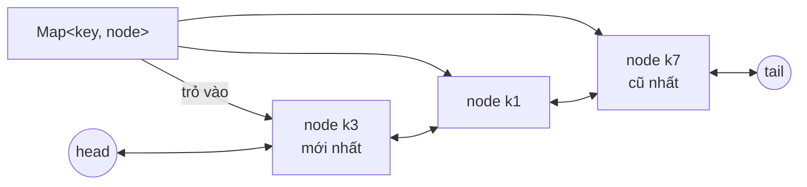

# DESIGN · LRU cache (mẫu theo khung 7 bước)

> Đề mơ hồ: *"Service giá sản phẩm cần cache trong bộ nhớ, đừng để nó ăn hết RAM."*

## 1. API & ngữ nghĩa
| Câu hỏi | Chốt |
|---|---|
| Chữ ký? | `get(key: int): int` (`-1` nếu thiếu), `put(key, value): void` |
| Chính sách evict? | Bỏ key **dùng lâu nhất** (LRU) |
| Gì là "dùng"? | `get` thành công và mọi `put` (kể cả key đã có) |
| `get` key lạ có đổi trạng thái? | Không |
| `capacity = 0`? | Hợp lệ: `put` không lưu gì |
| Có TTL? | Không (xem bước 7) |
| Key/giá trị? | `int` (key kiểu object cần băm khác → ngoài phạm vi) |

## 2. Tải & ràng buộc
- `capacity` tới `10⁵`–`10⁶`, `10⁵`–`10⁶` thao tác; đọc nhiều hơn ghi; **cả hai** phải O(1) vì nằm trên đường nóng của request.
- RAM giới hạn ⇒ kích thước cache *tuyệt đối* bị chặn bởi `capacity`.

## 3. Bất biến
1. `map.size ≤ capacity` và `map.size` = số node trong DLL.
2. Mỗi key có đúng một node; `map[key].key === key`.
3. Thứ tự DLL từ `head.next` đến `tail.prev` = từ mới dùng nhất đến cũ nhất.
4. Key bị evict không còn trong `map` (không rò tham chiếu).

## 4. Ghép cấu trúc

`put` khi đầy:
```mermaid
sequenceDiagram
    participant C as Client
    participant M as map
    participant L as DLL
    C->>M: put(k9, v)  (k9 chưa có, size == cap)
    M-->>C: miss
    Note over L: bất biến trước: size == cap
    C->>L: old = tail.prev ; unlink(old)
    C->>M: delete(old.key)
    C->>L: pushFront(newNode k9)
    C->>M: set(k9, node)
    Note over L: bất biến sau: size == cap, k9 ở đầu
```

Phương án khác: `Map` của JS nhớ thứ tự chèn ⇒ `delete` + `set` lại để "đưa lên cuối", evict `keys().next()`. Ngắn gọn, đủ dùng thực tế, nhưng mất kiểm soát thứ tự bộ nhớ; chọn DLL để thấy rõ cấu trúc.

## 5. Bảng độ phức tạp
| Thao tác | Time | Space |
|---|---|---|
| `get` | O(1) | – |
| `put` (mới, đầy) | O(1) | – |
| `put` (key có) | O(1) | – |
| Toàn bộ | – | O(capacity) |

## 6. Cài đặt & stress test
- `solutions.ts` → `LRUCache` (DLL + sentinel); bản ngây thơ `NaiveLRU` (mảng, `findIndex`/`splice`) dùng làm brute.
- `DSA_PERF_FACTOR=3 node tools/check.ts lessons/D02-lru-lfu 01 --src solutions`: stress 300 chuỗi thao tác ngẫu nhiên (capacity 0–4) so với brute, perf 10⁵ thao tác ở capacity 5 000.
- Một bản "mảng + findIndex" cho cùng thao tác bị Perf bắt (đã thử: vượt giới hạn 300 ms).
- `node tools/bench.ts lessons/D02-lru-lfu 01 --src solutions --scales s,m,l` (capacity cố định 5 000):

| n thao tác | median | số mũ | heap |
|---|---|---|---|
| 10³ | 0.11 ms | – | 0.4 MB |
| 10⁵ | 14.6 ms | 1.06 | 5.2 MB |
| 10⁶ | 235 ms | 1.21 | 50.7 MB |

Tổng thời gian tăng gần tuyến tính theo số thao tác ⇒ chi phí mỗi thao tác hằng số (O(1)); phần tăng nhẹ của số mũ là hiệu ứng cache CPU/GC.

## 7. Đánh đổi & mở rộng
- **×10 dữ liệu:** mỗi node là object 4 trường + một ô trong `Map` ⇒ ~nhiều chục byte/phần tử; 10⁷ phần tử cần chuyển sang chỉ số + typed array (`prev[]`, `next[]`, `keys[]`, `vals[]`) và `Map<key, idx>`.
- **Đa luồng:** `get` *ghi* (đổi thứ tự) ⇒ không thể đọc song song; thực tế dùng shard theo hash(key), hoặc chấp nhận LRU xấp xỉ (Caffeine/`ConcurrentLinkedHashMap` ghi nhận truy cập vào buffer rồi áp dụng sau).
- **Nhiều instance:** mỗi instance một cache ⇒ tỉ lệ hit giảm, dữ liệu có thể lệch giữa các instance; cần TTL + invalidation hoặc Redis (`maxmemory-policy allkeys-lru` dùng LRU xấp xỉ theo mẫu).
- **Nút thắt khi ghi ×10:** vẫn O(1), nhưng GC của hàng triệu node ngắn hạn ⇒ tái dùng node bị evict thay vì cấp phát mới.
- **Scan pollution:** một lượt duyệt qua nhiều key lạ đẩy hết key nóng ra khỏi LRU ⇒ biến thể 2Q / SLRU / LFU có aging.
