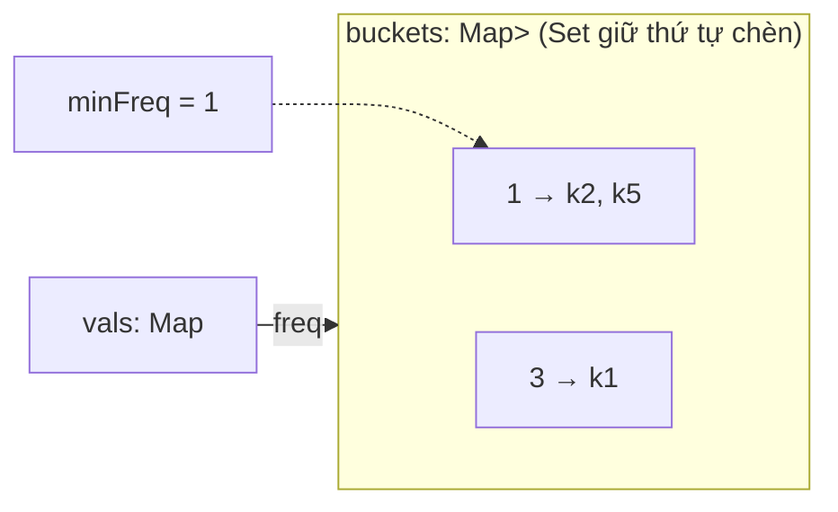

# DESIGN · LFU cache (mẫu theo khung 7 bước)

> Đề (mơ hồ): *"Cache giá sản phẩm: giữ những sản phẩm được xem nhiều nhất, hết chỗ thì bỏ bớt."*
> LRU (ex01) dùng cùng khung nhưng đơn giản hơn; những chỗ khác nhau ghi ở cuối.

## 1 · API & ngữ nghĩa
| Câu hỏi | Chốt |
|---|---|
| Thao tác? | `get(key) → value hoặc -1`, `put(key, value)` |
| "Nhiều nhất" tính thế nào? | Số lần `get` thành công + số lần `put` (kể cả cập nhật). Key mới có đếm 1 |
| Hòa tần suất? | Bỏ key **dùng lâu nhất** (LRU trong nhóm) |
| Key bị bỏ rồi quay lại? | Bắt đầu lại từ đếm 1 |
| `capacity = 0`? | Không lưu gì |
| `put` key có sẵn? | Cập nhật value, tính 1 lần dùng, **không** evict |
| TTL / đa luồng? | Ngoài phạm vi (xem Bước 7) |

## 2 · Tải & ràng buộc
`capacity ≤ 10⁵`, `10⁵` thao tác (mở rộng 10⁶). `get` chiếm đa số → cả `get` và `put` đều phải O(1). Quét tìm nạn nhân O(capacity) cho mỗi `put` sẽ cho `10⁵ × 2·10⁴ ≈ 10⁹` bước (đo: bản ngây thơ ≈ 4 s ở 10⁵ thao tác, bản O(1) ≈ 55 ms).

## 3 · Bất biến
1. **(I1)** `vals` chứa đúng các key đang lưu, `|vals| ≤ capacity`; mỗi key có `freq ≥ 1`.
2. **(I2)** Mỗi key nằm **đúng một** bucket: `buckets[vals[key].freq]`; mọi bucket được lưu đều **không rỗng**.
3. **(I3)** Trong một bucket, thứ tự chèn = thứ tự lần chạm cuối tăng dần (đầu = lâu nhất).
4. **(I4)** Cache không rỗng ⇒ `minFreq = min{freq}` và `buckets[minFreq]` tồn tại.

## 4 · Ghép DS

| Phương án | Nhận xét |
|---|---|
| Heap theo (freq, time) | O(log n); `touch` cần sửa key ở giữa heap |
| **Map + bucket theo freq + minFreq** (chọn) | O(1) cho mọi thao tác |
| DLL-of-DLL (bài báo gốc) | O(1) và không dựa vào thứ tự của `Set`; nhiều con trỏ hơn |

Luồng `put(newKey)` khi đầy: (1) lấy `victim` = phần tử đầu `buckets[minFreq]`; (2) xóa khỏi bucket (xóa bucket nếu rỗng) và khỏi `vals`; (3) thêm key mới vào `buckets[1]`; (4) `minFreq = 1`. Bước (4) **sau** (1)-(3) vì bước (1) cần `minFreq` cũ.

## 5 · Độ phức tạp
| Thao tác | Time | Space |
|---|---|---|
| `get` | O(1) (delete khỏi Set + add vào Set khác) | – |
| `put` cập nhật | O(1) | – |
| `put` mới (có evict) | O(1) | O(capacity) tổng |

`Set.delete/add/values().next()` là O(1) trung bình trong V8. Hằng số lớn hơn LRU (≈ 2.4× ở 10⁵ thao tác: 55 ms vs 23 ms).

## 6 · Cài đặt & kiểm chứng
- Oracle `NaiveLFU` trong `checks.ts`: mảng entry, evict bằng quét tìm `(freq, lastTouch)` nhỏ nhất.
- Stress: 300 chuỗi ≤ 80 thao tác, capacity 0–5, 9 key (nhiều evict + hòa).
- Bench (`node tools/bench.ts lessons/D02-lru-lfu 02 --src solutions --scales s,m,l`): 10³ → 0.16 ms · 10⁵ → 55 ms · 10⁶ → 468 ms (số mũ 10⁵→10⁶ ≈ 0.93: tiệm cận O(n) tổng).

## 7 · Đánh đổi & mở rộng
| Câu hỏi | Trả lời |
|---|---|
| LRU vs LFU? | LRU thích nghi nhanh, nhưng **một lần scan lớn đẩy sạch phần nóng** (scan resistance kém). LFU giữ hot lâu dài nhưng **cache pollution**: key từng rất hot giữ chỗ mãi → thực tế dùng LFU có suy giảm (aging) hoặc TinyLFU/W-TinyLFU (Caffeine), Redis dùng bộ đếm log xác suất + decay |
| TTL? | Thêm `expireAt` vào entry; dọn lười khi `get`, dọn định kỳ theo một heap/timer wheel (D08). Evict hết hạn trước khi evict theo freq |
| x10 dữ liệu? | ≈ 470 ms, ≈ 64 MB cho 10⁶ thao tác. Với 10⁷ key: object/Map overhead lớn → cân nhắc mảng typed + băm tự cài |
| Đa luồng? | Lock ở `get` vì `get` cũng ghi (sửa thứ tự/đếm) — nút thắt của mọi cache LRU/LFU. Giải pháp: bộ đệm ghi sự kiện batch (Caffeine), hoặc chia shard theo hash key |
| Nhiều instance? | Cache cục bộ mỗi nơi → hit-rate thấp hơn, dữ liệu lệch. Đưa ra Redis khi cần nhất quán/chia sẻ |
| Bộ nhớ khi evict? | Xóa tham chiếu khỏi `vals` **và** bucket; không để bucket rỗng |
