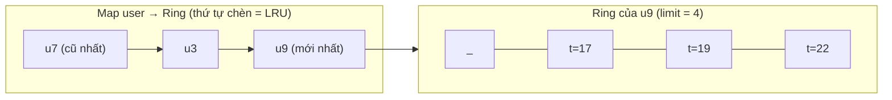

# DESIGN · PerUserLimiter (mẫu theo khung 7 bước)

> Đề (mơ hồ): *"Mỗi user chỉ được gọi API N lần mỗi khoảng thời gian; hệ thống có rất nhiều user."*

## 1 · API & ngữ nghĩa
| Câu hỏi | Chốt |
|---|---|
| Chữ ký | `allow(user, t) → boolean`, thời gian `t` do caller đưa (tái lập được) |
| "N lần mỗi khoảng" | Cửa sổ **trượt** `[t−W+1, t]`, đếm request *được cho phép* |
| Request bị từ chối có tính không? | Không (nếu tính, user spam sẽ tự khóa mãi) |
| Quá nhiều user? | Tối đa `maxUsers`, evict user **lâu không gọi nhất** |
| User bị evict quay lại? | Như user mới (lịch sử mất) |
| Thời gian lùi? | Không (`t` không giảm) |

## 2 · Tải & ràng buộc
`10⁵` lời gọi (mở rộng 10⁶), `limit ≤ 100`, `maxUsers ≤ 10⁵`. Thao tác duy nhất `allow` nằm trên đường nóng của mọi request → phải O(1). Bộ nhớ trần: `maxUsers × limit` số ≈ 10⁷ số = ~80 MB nếu `Float64`, ~40 MB nếu `Int32Array` — ở mức chấp nhận được.

## 3 · Bất biến
1. **(I1)** `|users| ≤ maxUsers`.
2. **(I2)** Ring của mỗi user chứa tối đa `limit` mốc của các request *được phép* gần nhất, sắp tăng dần.
3. **(I3)** Với ring đầy: số request trong cửa sổ `= limit` ⇔ mốc cũ nhất `≥ t − W + 1`. Ring chưa đầy ⇒ số request trong cửa sổ `< limit` ⇒ luôn cho phép.
4. **(I4)** Thứ tự chèn của `Map` = thứ tự lần gọi cuối tăng dần ⇒ khóa đầu tiên là user lâu không gọi nhất.

## 4 · Ghép DS

| Phương án | Nhận xét |
|---|---|
| Lưu mọi mốc, quét đếm | Không chặn bộ nhớ, `allow` O(lịch sử) — đo: ngây thơ ≈ 700 ms vs ref ≈ 60 ms ở 10⁵ lời gọi |
| Queue các mốc + dọn đầu | O(1) am., bộ nhớ O(request trong cửa sổ) = có thể lớn hơn `limit`? Không (≤ `limit` vì từ chối không ghi), nhưng cấp phát/GC nhiều hơn ring |
| **Ring `limit` ô + Map LRU** (chọn) | O(1), bộ nhớ cố định/user |
| Token bucket | 2 số/user, rẻ nhất, nhưng cho burst tới `limit` rồi nhỏ giọt — ngữ nghĩa khác "cửa sổ" |

Luồng `allow(u, t)`:
1. Tìm ring của `u`; có → `delete` khỏi Map (sẽ `set` lại ở cuối = chạm). Không có và đầy → đuổi khóa đầu, **tái dùng** ring của nó.
2. Ring đầy và `buf[start] > t − W` ⇒ từ chối. Ngược lại bỏ mốc cũ nhất (nếu đầy), ghi `t`, cho phép.

## 5 · Độ phức tạp
| Thao tác | Time | Space |
|---|---|---|
| `allow` | O(1) (Map get/delete/set + vài phép số học) | O(maxUsers × limit) |
| Evict | O(1) | – |

## 6 · Cài đặt & kiểm chứng
- Oracle: lịch sử đầy đủ mỗi user, `filter` đếm trong cửa sổ, user LRU bằng mảng `indexOf/splice`.
- Stress: 300 chuỗi ≤ 80 lời gọi, `limit 1–3`, `W 1–6`, `maxUsers 1–4`, 7 user (nhiều đuổi, nhiều biên cửa sổ).
- Bench (`--scales s,m,l`): 10³ → 0.28 ms · 10⁵ → 56 ms · 10⁶ → 932 ms; heap ≈ 9.5 MB → 20 MB (bị chặn bởi `maxUsers × limit`, không tăng 10× theo số lời gọi). Số mũ 10⁵→10⁶ ≈ 1.2: chi phí churn của `Map` (delete/set) và cache miss khi 8 000 user + vòng đệm không còn vừa cache.

## 7 · Đánh đổi & mở rộng
| Câu hỏi | Trả lời |
|---|---|
| Evict-LRU bị lợi dụng thế nào? | Gửi request từ 10⁷ key giả đẩy key thật ra → key thật mất lịch sử (được phép lại). Giảm nhẹ: giới hạn theo IP trước, bucket riêng cho key đã xác thực, hoặc evict "ít hoạt động nhất" thay vì "lâu nhất" |
| x10 user? | Bộ nhớ vẫn bị chặn; chọn `maxUsers` theo ngân sách RAM; dùng `Int32Array` phẳng (`maxUsers × limit`) + Map user → slot để bớt GC |
| 4 pod? | Mỗi pod đếm riêng ⇒ hạn mức thực tế tới `4 × limit` (nếu cân bằng tải ngẫu nhiên). Sticky session theo user, hoặc store chung (Redis), hoặc chấp nhận xấp xỉ |
| Redis? | `INCR` + `EXPIRE` (fixed window), hoặc sorted set `ZADD` + `ZREMRANGEBYSCORE` + `ZCARD` trong Lua (sliding log chính xác, tốn O(log n) và RTT) |
| Đồng hồ? | `t` do caller truyền; trên production dùng đồng hồ đơn điệu, tránh `Date.now()` nhảy lùi |
| Thư viện thật | Nginx `limit_req` (leaky bucket), Envoy local rate limit (token bucket), `rate-limiter-flexible` (Node), Guava `RateLimiter` |
