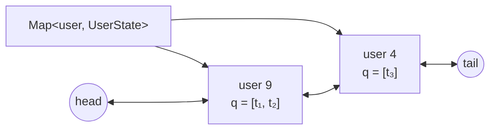

# DESIGN · Rate limiter theo user (mẫu theo khung 7 bước)

> Đề mơ hồ: *"Gateway cần giới hạn số request mỗi user, nhưng không được nhớ tất cả user mãi mãi."*

## 1. API & ngữ nghĩa
| Câu hỏi | Chốt |
|---|---|
| Chữ ký | `allow(user: int, t: long): boolean` |
| Cửa sổ | trượt, nửa mở `(t − windowMs, t]` |
| Thuật toán | sliding window **log**: đếm các request **đã được cho phép** trong cửa sổ |
| Request bị từ chối | không ghi nhận (không làm tăng quota đã dùng) |
| Thời gian | `t` do caller truyền, không giảm (test tất định; không dùng đồng hồ nội bộ) |
| Quá `maxUsers` | quên user **thấy lâu nhất** (kể cả lần bị từ chối cũng là "thấy") |
| User bị quên quay lại | như user mới — fail-open, ghi rõ trong đánh đổi |

## 2. Tải & ràng buộc
- `10⁵`–`10⁶` request/s ở peak, số user khác nhau không giới hạn (có kẻ tấn công), RAM chặn trên.
- `allow` nằm trên đường nóng ⇒ O(1) amortized.
- `limit ≤ 100` ⇒ hàng đợi nhỏ mỗi user.

## 3. Bất biến
1. `users.size ≤ maxUsers`.
2. Mỗi user có hàng đợi tăng dần các timestamp của request được cho phép; sau khi vứt hết `≤ t − windowMs` còn `≤ limit` phần tử.
3. DLL xếp user theo thứ tự "thấy lần cuối": `head.next` mới nhất, `tail.prev` cũ nhất; mỗi user đúng một node.
4. Mỗi lần `allow(u)` (kết quả bất kỳ) đưa `u` lên `head.next`.

## 4. Ghép cấu trúc

- `Map` cho tra O(1); DLL cho thứ tự evict O(1) (đúng khuôn LRU của D02).
- Hàng đợi mỗi user: mảng + chỉ số `head` (không `shift()`), cắt phần đã dùng khi `head` quá nửa.

| Phương án | Nhận xét |
|---|---|
| Fixed window | 1 số/user nhưng cho phép tới 2× limit quanh ranh giới |
| Token bucket | O(1)/user, cho phép burst; không "đếm cửa sổ" nên đề này không dùng |
| Sliding window counter | xấp xỉ, 2 số/user; sai số cho phép trong thực tế nhưng khó có brute chính xác |
| **Sliding window log** (chọn) | chính xác, O(limit)/user, test được bằng brute |

## 5. Bảng độ phức tạp
| Thao tác | Time | Ghi chú |
|---|---|---|
| `allow` | O(1) amortized | mỗi timestamp vào và ra hàng đợi 1 lần; DLL/Map O(1) |
| Space | O(maxUsers · limit) | chặn trên cứng, bất kể số user thật |

## 6. Cài đặt & stress test
- `solutions.ts` → `PerUserLimiter`; brute: `NaiveLimiter` (mảng thứ tự user + lọc toàn bộ log).
- Stress: 300 chuỗi ngẫu nhiên (`limit` 1–3, `windowMs` 1–20, `maxUsers` 1–4, 6 user) so với brute — đủ nhỏ để eviction xảy ra liên tục.
- Phát hiện khi viết: bản dùng `Map` + `delete`/`set` + `keys().next()` để lấy user cũ nhất chạy 385 ms ở perf 10⁵ (so với DLL 46 ms), nên đáp án mẫu dùng DLL.
- `node tools/bench.ts lessons/D03-hit-counter-rate-limiter 02 --src solutions --scales s,m,l` (50 000 user, `maxUsers` 10 000):

| n | median | số mũ | heap |
|---|---|---|---|
| 10³ | 0.39 ms | – | 0.2 MB |
| 10⁵ | 40.5 ms | 1.01 | 28.7 MB |
| 10⁶ | 574 ms | 1.15 | 244 MB |

Thời gian ~tuyến tính theo số request ⇒ O(1)/request. Heap 244 MB ở 10⁶ là phần lớn do mảng `args` của chính bench (10⁶ cặp).

## 7. Đánh đổi & mở rộng
- **×10 dữ liệu:** bộ nhớ mỗi user = object + mảng + node DLL. Với `maxUsers = 10⁷`, chuyển sang token bucket (2 số/user trong typed array) hoặc sharding theo hash(user).
- **Fail-open khi evict:** kẻ tấn công dùng `maxUsers + 1` user xoay vòng sẽ luôn được làm mới quota. Giảm thiểu: giới hạn theo IP/ASN ở lớp trước, hoặc tăng `maxUsers`, hoặc giữ một Bloom filter / count-min sketch (xem R07) cho user đã bị evict.
- **Nhiều instance sau load balancer:** mỗi instance đếm riêng ⇒ giới hạn thật = `limit × số instance` nếu request rải đều. Cần sticky routing theo `user`, hoặc Redis (`INCR` + `EXPIRE`, sorted set cho sliding log, hoặc script Lua để nguyên tử).
- **Đa luồng:** `allow` ghi trạng thái ⇒ cần khóa theo shard (hash user → shard).
- **Nút thắt khi ghi ×10:** vẫn O(1), GC của các mảng nhỏ ⇒ tái dùng hàng đợi (object pool) hoặc ring buffer cố định `limit` phần tử.
- **Hệ thống thật:** Nginx `limit_req` (leaky bucket), Envoy/Redis-based limiter, Stripe dùng token bucket.
