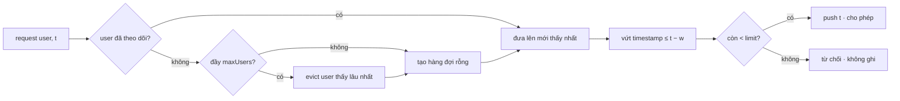

# D03 · Hit counter & rate limiter

## Sau buổi này bạn sẽ
- Đếm sự kiện theo **cửa sổ thời gian** với bộ nhớ có chặn trên (vòng bucket, hàng đợi timestamp).
- Phân biệt bốn thuật toán giới hạn tốc độ: **fixed window**, **sliding window log**, **sliding window counter**, **token bucket**.
- Thiết kế rate limiter **nhiều user** mà bộ nhớ không tăng theo số user: evict user lâu không thấy.
- Chốt ngữ nghĩa biên của cửa sổ: nửa mở `(t − w, t]`.

## 1. Cửa sổ thời gian — chốt biên trước

"Trong 300 giây gần nhất" có thể là `[t − 300, t]` hoặc `(t − 300, t]`. Hai cách khác nhau đúng ở giây `t − 300`. Đề của module này dùng **`(t − w, t]`**: sự kiện lúc `x` còn tính khi `t − x < w`. Luôn dry-run một ví dụ ngay tại biên.

```
w = 300          t = 300
   ... 0 | 1 2 3 ... 299 300          hit ở giây 0 đã hết hạn, giây 1 còn
         └───── (0, 300] ─────┘
```

## 2. Hit counter: vòng bucket

Với cửa sổ **cố định 300 giây**, giữ 300 bucket, bucket `t % 300`:
```
times : [  301, 2, 3, ... ]    ← giây mà bucket đang đại diện
counts: [   1, 4, 2, ... ]
hit(301): i = 1; times[1] = 301 ≠ 1?  ghi đè
getHits(t): cộng counts[i] nếu t − times[i] < 300
```
Bộ nhớ O(300) dù có 10⁶ hit/giây. Bản "lưu mọi timestamp rồi lọc" là O(số hit) mỗi lần hỏi.

## 3. Bốn thuật toán rate limiter

| | Ý tưởng | Bộ nhớ / user | Chính xác | Burst |
|---|---|---|---|---|
| Fixed window | 1 bộ đếm cho mỗi khung cố định `[kW, (k+1)W)` | O(1) | cho phép tới 2× limit quanh ranh giới | có |
| Sliding window **log** | hàng đợi timestamp các request được phép | O(limit) | chính xác | không |
| Sliding window **counter** | 2 bộ đếm (khung trước, khung này) nội suy theo phần trăm | O(1) | xấp xỉ | ít |
| Token bucket | `tokens` + `lastRefill`, nạp theo thời gian | O(1) | không phải "đếm cửa sổ" | cho phép burst tới dung lượng |

Bài `PerUserLimiter` dùng **sliding window log**: đúng nhất, đơn giản để chứng minh, bộ nhớ O(limit) mỗi user.

## 4. Nhiều user: bộ nhớ phải bị chặn

Nếu cứ tạo trạng thái cho mỗi user mới, kẻ tấn công dùng 10⁷ user khác nhau là đủ làm sập RAM. Cách chặn:
- Giữ tối đa `maxUsers`; thấy user mới khi đã đủ thì **evict user được thấy lâu nhất** (LRU, D02).
- Hệ quả (ghi vào đánh đổi!): user bị evict được **làm mới quota**. Đó là *fail-open*. Hệ thống cần chặn nghiêm thì tăng `maxUsers`, đặt limiter ở Redis, hoặc đặt giới hạn theo IP/ASN ở lớp trước.
- Yêu cầu bị **từ chối vẫn phải đánh dấu "đã thấy"**: nếu không, user spam bị từ chối sẽ trôi xuống cuối và bị evict, rồi được làm mới quota.



## 5. Dấu hiệu nhận biết
"trong N giây gần nhất", "tối đa K yêu cầu mỗi W", "mỗi user/IP/API key", "không để bộ nhớ phình", "burst".

## 6. Theo ngôn ngữ

| | TS | Python | Java |
|---|---|---|---|
| Hàng đợi timestamp | mảng + chỉ số `head` (đừng `shift()`) | `collections.deque` | `ArrayDeque<Long>` |
| Thứ tự "thấy gần nhất" | DLL tự cài (xem D02) | `OrderedDict.move_to_end` | `LinkedHashMap(…, accessOrder = true)` |
| Timestamp ms | `number` (an toàn tới 2⁵³) | `int` | **`long`** — `int` tràn sau ~24.8 ngày tính theo ms |

## 7. Bẫy
1. Nhầm biên cửa sổ (`<=` thay `<`) → lệch 1 tại giây thứ 300.
2. Ghi cả request bị từ chối vào hàng đợi → user bị khóa vĩnh viễn khi spam.
3. Chỉ cập nhật "thấy gần nhất" khi được phép (xem mục 4).
4. `queue.shift()` O(n) trên hàng đợi lớn.
5. Dùng `Date.now()` trong lớp (khó test); nhận `t` làm tham số (như đề) để test tất định.
6. Java: `windowMs` và `t` kiểu `int` → tràn.

## 8. Độ phức tạp
| | Thời gian | Bộ nhớ |
|---|---|---|
| `HitCounter.hit` | O(1) | O(300) |
| `HitCounter.getHits` | O(300) = O(1) | |
| `PerUserLimiter.allow` | O(1) amortized | O(maxUsers · limit) |

🧭 Câu hỏi quy mô: hit counter với `10⁶` hit/giây trong 300 giây — hàng đợi timestamp tốn bao nhiêu phần tử? vòng bucket tốn bao nhiêu? Rồi dự đoán thời gian cho `10⁶` thao tác `allow` và `bench` (scale `l`).

Xem [`DESIGN.md`](./DESIGN.md) cho thiết kế `PerUserLimiter` đầy đủ 7 bước.
