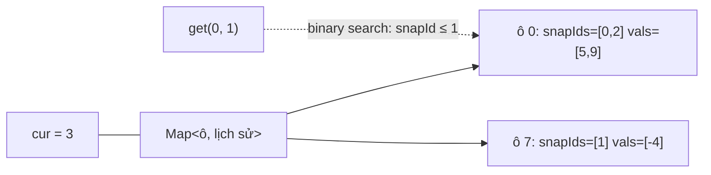
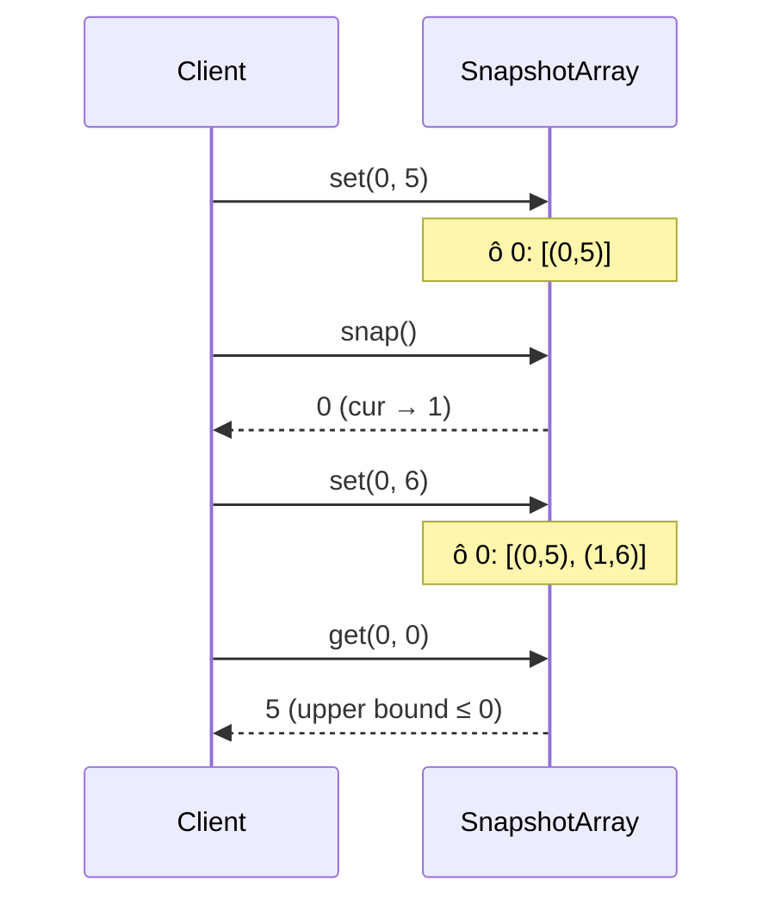

# DESIGN · SnapshotArray — cấu hình có phiên bản (mẫu theo khung 7 bước)

> Đề mơ hồ: *"Cần xem được giá trị của một cờ cấu hình tại bất kỳ lần deploy nào trong quá khứ."*

## 1. API & ngữ nghĩa
| Câu hỏi | Chốt |
|---|---|
| Chữ ký | `set(i, v)`, `snap(): snapId`, `get(i, snapId): int` |
| Giá trị ban đầu | `0` |
| `snapId` | tăng dần từ 0, trả bởi `snap()` |
| `set` sau `snap` | thuộc phiên bản kế tiếp, không đổi snapshot đã chụp |
| `get` với `snapId` chưa tồn tại | không xảy ra (tiền điều kiện) |
| Hai `set` cùng ô trong cùng phiên bản | giữ giá trị cuối |
| Xóa snapshot cũ? | Không (xem bước 7) |

## 2. Tải & ràng buộc
- `length` tới `10⁶`, `10⁵` thao tác, số snapshot tới `10⁴`–`10⁵`.
- Phần lớn ô **không** bao giờ đổi trong một phiên bản ⇒ lưu "thay đổi" rẻ hơn lưu "trạng thái".
- Mục tiêu: `set`, `snap` O(1) hoặc O(log n); `get` O(log k).

## 3. Bất biến
1. `cur` = số `snap()` đã gọi = `snapId` của phiên bản đang soạn thảo.
2. Với mỗi ô có lịch sử: `snapIds[]` tăng **nghiêm ngặt** (không trùng), mọi `snapIds[j] ≤ cur`.
3. Giá trị của ô `i` tại snapshot `s` = `vals[j]` với `j` lớn nhất có `snapIds[j] ≤ s`; không có `j` ⇒ `0`.
4. Ô chưa từng `set` không có mục nào trong `Map`.

## 4. Ghép cấu trúc

| Phương án | Vì sao không |
|---|---|
| Sao chép mảng mỗi `snap` | O(length) thời gian + bộ nhớ mỗi lần |
| Một mảng `Array(length)` các mảng con | cấp phát `length` đối tượng dù không dùng |
| **`Map` thưa + lịch sử theo ô** (chọn) | bộ nhớ tỉ lệ số lần `set` |

## 5. Bảng độ phức tạp
| Thao tác | Time | Space |
|---|---|---|
| `set` | O(1) (Map + push/ghi đè) | O(1) mỗi lần đổi giá trị |
| `snap` | O(1) | O(1) |
| `get` | O(log k) | – |
| Tổng | – | O(số lần `set`), không phụ thuộc `length`, số `snap` |

## 6. Cài đặt & stress test
- `solutions.ts` → `SnapshotArray`; brute `NaiveSnapshotArray` (sao chép mảng mỗi snap).
- Stress: `length` 1–5, ngẫu nhiên `set/snap/get` so với brute (300 lần).
- Perf: `length = 10⁵`, 25% `snap`: bản sao chép đầy đủ vượt giới hạn (đã thử: bị dừng sau 750 ms trong khi giới hạn là 250 ms).
- `node tools/bench.ts lessons/D04-time-based-kv 02 --src solutions --scales s,m,l`:

| n | median | số mũ | heap |
|---|---|---|---|
| 10³ | 0.09 ms | – | 0.0 MB |
| 10⁵ | 15.9 ms | 1.14 | 16.8 MB |
| 10⁶ | 465 ms | 1.47 | 56.7 MB |

Số mũ 1.47 ở bước cuối cao hơn lý thuyết (O(log k) mỗi `get`): một phần do `Map` lớn dần vượt cache CPU, một phần do GC của hàng trăm nghìn mảng nhỏ.

## 7. Đánh đổi & mở rộng
- **×10 dữ liệu:** mỗi ô có lịch sử là 2 mảng nhỏ ⇒ chi phí đối tượng lớn hơn chính dữ liệu. Chuyển sang 1 mảng phẳng toàn cục `(ô, snapId, giá trị)` sắp theo `(ô, snapId)`; hoặc ghi vào log rồi dựng chỉ mục khi cần.
- **Xóa snapshot cũ:** nếu chỉ giữ N phiên bản gần nhất, mỗi ô cắt phần đầu lịch sử tới mục cuối có `snapId ≤ minSnap` (giữ 1 mục làm "giá trị gốc").
- **Đa luồng:** `set` đơn luồng; đọc snapshot cũ thì bất biến ⇒ có thể đọc song song sau khi chụp (immutable history).
- **Nhiều instance / bền vững:** log thay đổi ghi vào WAL/DB (event sourcing) ⇒ dựng lại khi restart. Hệ thống thật: MVCC của PostgreSQL (mỗi dòng có `xmin/xmax`), Git (mỗi commit chỉ lưu thay đổi), etcd (revision).
- **Nút thắt khi ghi ×10:** `Map.set` và cấp phát mảng; có thể gom thay đổi của một phiên bản vào một mảng rồi gộp khi `snap()`.
