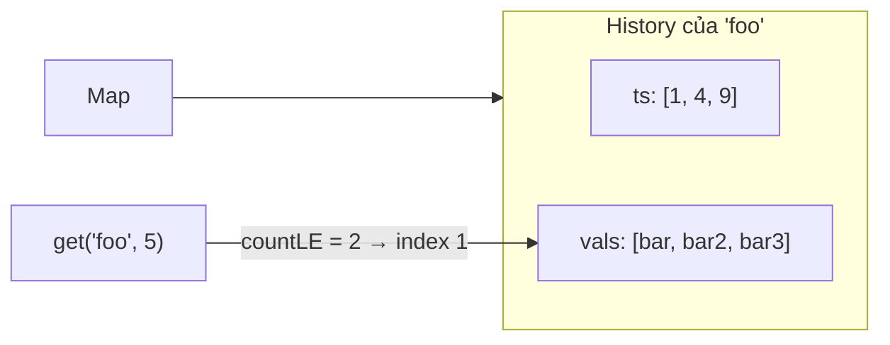

# DESIGN · TimeMap — KV có phiên bản theo thời gian (mẫu theo khung 7 bước)

> Đề (mơ hồ): *"Lưu giá trị của khóa theo thời gian để sau này hỏi 'lúc đó là gì'."*

## 1 · API & ngữ nghĩa
| Câu hỏi | Chốt |
|---|---|
| Thao tác | `set(key, value, ts)`, `get(key, ts) → string` |
| `get` trả gì? | Giá trị của lần `set` có `ts'` lớn nhất thỏa `ts' ≤ ts` |
| Không có? | `""` (key lạ hoặc `ts` trước mọi bản ghi) |
| Thứ tự `set` | Timestamp tăng ngặt (đề bảo đảm) ⇒ lịch sử tự sắp |
| Xóa / hồi tố | Ngoài phạm vi; xem Bước 7 |

## 2 · Tải & ràng buộc
`10⁵` lời gọi (mở rộng 10⁶). Nếu `get` quét hết lịch sử thì `O(tổng bản ghi)` mỗi lần: đo ngây thơ ≈ 9.3 s ở 10⁵ thao tác (5 key, ~25 000 bản ghi/key), bản binary search ≈ 16 ms.

## 3 · Bất biến
1. **(I1)** `ts[key]` tăng ngặt; `vals[key][i]` là giá trị đặt tại `ts[key][i]`; hai mảng cùng độ dài.
2. **(I2)** Mọi bản ghi chỉ được thêm vào cuối, không bao giờ sửa/xóa.
3. **(I3)** `get(key, t)` = `vals[key][countLE(ts[key], t) − 1]` nếu `countLE > 0`, ngược lại `""`.

## 4 · Ghép DS

| Phương án | Nhận xét |
|---|---|
| Danh sách `(key, ts, value)` phẳng, quét | Đúng chắc → dùng làm **oracle** |
| **Map key → 2 mảng song song + binary search** (chọn) | Append O(1), tra O(log m), ít bộ nhớ hơn mảng object |
| `Map<key, TreeMap<ts, value>>` | Chịu được `set` không theo thứ tự (O(log m)), nhưng JS phải tự cài cây |
| Mảng object `{ts, value}` | Dễ đọc hơn, tốn thêm một object mỗi bản ghi |

## 5 · Độ phức tạp
| Thao tác | Time | Space |
|---|---|---|
| `set` | O(1) amortized | +2 ô |
| `get` | O(log m), m = số bản ghi của key | – |
| Tổng | – | O(tổng số `set`) |

## 6 · Cài đặt & kiểm chứng
- Oracle: mảng phẳng `[key, value, ts]`, `get` quét tất cả lấy `ts` lớn nhất ≤ t.
- Stress: 300 chuỗi ≤ 80 thao tác, 3 key, `get` ở timestamp ngẫu nhiên kể cả trước mọi bản ghi và sau tất cả.
- Bench (TimeMap): 10³ → 0.16 ms · 10⁵ → 14 ms · 10⁶ → 256 ms (số mũ ≈ 1.25: cache miss khi mảng dài). SnapshotArray: 10⁵ → 31 ms, 10⁶ → 327 ms, heap ≈ 53 MB (không phụ thuộc số snap); bản sao chép cả mảng ≈ 5.8 s chỉ ở 3·10⁴ thao tác.

## 7 · Đánh đổi & mở rộng
| Câu hỏi | Trả lời |
|---|---|
| Hồi tố (`set` timestamp cũ)? | Chèn có thứ tự: tìm vị trí bằng binary search + `splice` = O(m); hoặc `TreeMap`/skip list (D09) O(log m) |
| x10 dữ liệu | Mảng số JS dùng bộ nhớ lớn: `Float64Array`/`Int32Array` cho `ts` nếu số lượng cố định; nén delta |
| Truy vấn "mới nhất" chiếm đa số | `get` với `t ≥ ts.at(-1)` trả thẳng phần tử cuối (kiểm tra O(1) trước binary search) |
| Giữ lịch sử mãi? | Cần retention: cắt đầu mảng (dùng chỉ số bắt đầu) hoặc đẩy lịch sử cũ sang kho ngoài (Postgres + index `(key, ts DESC)`, `ORDER BY ts DESC LIMIT 1`) |
| Đa luồng / nhiều instance | Append-only dễ nhân bản (log); đọc không cần khóa nếu ghi publish độ dài sau cùng |
| Hệ thống thật | Event sourcing, bitemporal tables (SQL:2011), Datomic, DynamoDB sort key = timestamp |
