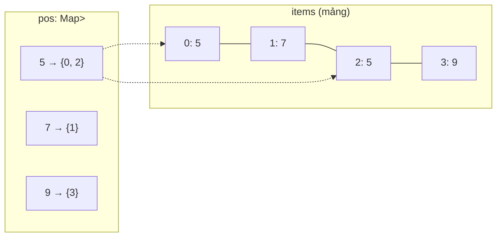

# DESIGN · RandomizedCollection (mẫu theo khung 7 bước)

> Đề (mơ hồ): *"Một tập các giá trị cho phép thêm, bớt, và bốc ngẫu nhiên một phần tử."*

## 1 · API & ngữ nghĩa
| Câu hỏi | Chốt |
|---|---|
| Có trùng không? | Có (đa tập) |
| `insert` trả gì? | `true` nếu giá trị chưa có trước đó |
| `remove` | Bỏ **một** bản sao; `false` nếu không có |
| "Ngẫu nhiên" | Đều trên **các bản sao** (giá trị xuất hiện 2 lần có xác suất gấp đôi) |
| `getRandom` khi rỗng | Không xảy ra (caller bảo đảm) |
| RNG | `Math.random()`; production nên tiêm RNG để test tái lập |

## 2 · Tải & ràng buộc
`10⁵` lời gọi (mở rộng 10⁶); cả ba thao tác phải O(1). `remove` bằng `indexOf + splice` là O(n): đo ngây thơ ≈ 1.2 s ở 10⁵ thao tác (~2·10⁴ phần tử), bản O(1) ≈ 35 ms.

## 3 · Bất biến
1. **(I1)** `items[i] = v ⇔ i ∈ pos[v]`.
2. **(I2)** `|items| = Σ |pos[v]|`; `pos` không chứa Set rỗng ⇒ `pos.has(v)` ⇔ `v` đang có.
3. **(I3)** `getRandom` chọn chỉ số đều trên `[0, |items|)` ⇒ mỗi bản sao đều xác suất `1/|items|`.

## 4 · Ghép DS

Luồng `remove(5)`: lấy `i` từ `pos[5]` → xóa `i` khỏi Set → nếu `i ≠ last`: chuyển phần tử cuối `m` vào `items[i]`, cập nhật `pos[m]`: bỏ `last`, thêm `i` → `items.pop()` → nếu `pos[5]` rỗng thì xóa khóa.

| Phương án | Nhận xét |
|---|---|
| Chỉ mảng | `remove` O(n) |
| Chỉ Map<val, count> | `getRandom` khó đều (phải duyệt) |
| **Mảng + Map<val, Set<idx>>** (chọn) | O(1) cả ba |
| Mảng + Map<val, idx[]> (stack chỉ số) | Nhanh hơn Set nhưng xóa chỉ số `last` của `m` phải tìm → O(k); Set tránh điều đó |

## 5 · Độ phức tạp
| Thao tác | Time | Space |
|---|---|---|
| `insert` | O(1) trung bình | +1 ô mảng, +1 phần tử Set |
| `remove` | O(1) trung bình | – |
| `getRandom` | O(1) | – |
Tổng space O(n) + overhead của `Set` cho mỗi giá trị khác nhau (nặng khi mọi giá trị đều khác nhau).

## 6 · Cài đặt & kiểm chứng
- Oracle `NaiveRC` (mảng + `indexOf/splice`). `compare` tùy biến: replay đa tập, `getRandom` chỉ cần trả giá trị đang có.
- Stress: 300 chuỗi ≤ 80 thao tác, giá trị 0–4 (nhiều trùng, nhiều xóa phần tử cuối).
- Bench: 10³ → 0.34 ms · 10⁵ → 33 ms · 10⁶ → 559 ms (số mũ ≈ 1.2, heap ≈ 52 MB: cấp phát Set cho từng giá trị).

## 7 · Đánh đổi & mở rộng
| Câu hỏi | Trả lời |
|---|---|
| Chọn có trọng số? | Fenwick/segment tree trên trọng số, O(log n) (A-series) hoặc alias method nếu tĩnh |
| 10⁷ giá trị khác nhau? | `Set` mỗi giá trị rất tốn RAM: dùng `pos: Map<val, number>` cho trường hợp **không trùng** (LC 380) — một số thay vì Set; với trùng, dùng danh sách chỉ số liên kết trong mảng typed |
| Thứ tự `remove` | Không ổn định (swap-with-last đảo thứ tự) — nếu cần thứ tự chèn, không dùng được cấu trúc này |
| RNG | Tiêm RNG có seed để test tái lập; `crypto.getRandomValues` nếu cần an toàn |
| Đa luồng | Cần khóa cả mảng và Map (hai cấu trúc phải đổi cùng nhau — bất biến I1) |
| Hệ thống thật | Redis `SRANDMEMBER`, `SPOP` (set không trùng; dùng mảng băm), Kafka partition assignor chọn ngẫu nhiên |
