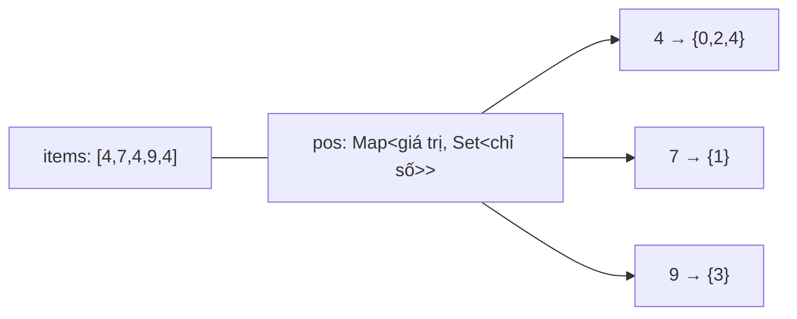
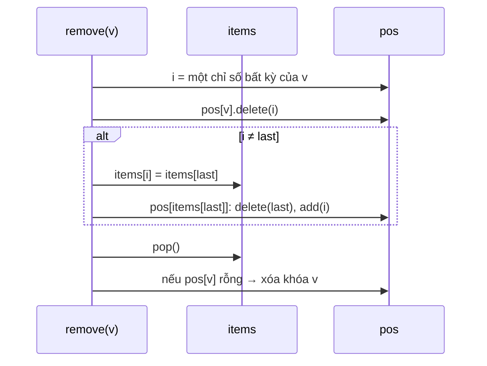

# DESIGN · RandomizedCollection (mẫu theo khung 7 bước)

> Đề mơ hồ: *"Cần chọn ngẫu nhiên một nạn nhân từ danh sách phiên đang hoạt động (Chaos Monkey), có thể có trùng, và phải thêm/xóa liên tục."*

## 1. API & ngữ nghĩa
| Câu hỏi | Chốt |
|---|---|
| Có trùng? | Có — multiset |
| `insert` trả gì? | `true` nếu giá trị **chưa có** trước lúc thêm |
| `remove` | xóa **một** bản sao; trả `false` nếu không có |
| `getRandom` | đều theo **bản sao** (xác suất `count/n`); tập rỗng không xảy ra |
| Thứ tự lưu | không bảo đảm |
| Giá trị | `int` |

## 2. Tải & ràng buộc
- Tập có `10⁵`–`10⁶` phần tử, `insert/remove/getRandom` xen kẽ; **cả ba** O(1) vì `getRandom` được gọi liên tục.
- Phân phối đều là yêu cầu *đúng đắn*, không phải tối ưu.

## 3. Bất biến
1. `items.length` = tổng số bản sao của mọi giá trị.
2. Với mọi chỉ số `i`: `i ∈ pos[items[i]]`; ngược lại mọi phần tử của `pos[v]` là chỉ số `i` có `items[i] = v`.
3. `pos[v]` tồn tại ⇔ `pos[v]` không rỗng (xóa khóa khi rỗng) — nhờ đó `insert` biết "đã có hay chưa" bằng `pos.has`.
4. Các chỉ số `0..n-1` đều thuộc đúng một `pos[·]`.

## 4. Ghép cấu trúc

`remove(7)` — các bước và bất biến:

| Phương án | Nhận xét |
|---|---|
| Mảng, `indexOf` + `splice` | remove O(n) |
| `Map<value, count>` + `getRandom` duyệt khóa | getRandom O(số giá trị phân biệt) hoặc sai phân phối |
| Map count + Fenwick lấy mẫu theo trọng số | getRandom O(log n), phức tạp hơn nhiều |
| **Mảng + Map<giá trị, Set<chỉ số>>** (chọn) | cả ba O(1) |

## 5. Bảng độ phức tạp
| Thao tác | Time | Ghi chú |
|---|---|---|
| `insert` | O(1) | `push` + thêm vào Set |
| `remove` | O(1) | swap-remove; Set `delete/add` O(1) |
| `getRandom` | O(1) | một lần random + truy cập mảng |
| Space | O(n) | mảng n ô + n chỉ số trong các Set |

## 6. Cài đặt & stress test
- `solutions.ts` → `RandomizedCollection`. Vì `getRandom` ngẫu nhiên, checker **mô phỏng lại** chuỗi thao tác (multiset đếm) để kiểm: boolean đúng, mỗi `getRandom` thuộc tập, và đợt `getRandom` ≥ 600 lần liên tiếp có tần suất ≈ `count/n` (±6σ). Thử một bản "chọn theo khóa phân biệt": bị bắt ở case phân phối (giá trị 1 xuất hiện 1555/3000 thay vì ≈ 2000).
- Bản ngây thơ `indexOf + splice` bị Perf bắt (2234 ms trong khi giới hạn 250 ms).
- `node tools/bench.ts lessons/D05-randomized-iterators 01 --src solutions --scales s,m,l`:

| n | median | số mũ | heap |
|---|---|---|---|
| 10³ | 0.29 ms | – | 0.6 MB |
| 10⁵ | 24.4 ms | 0.96 | 13.0 MB |
| 10⁶ | 480 ms | 1.29 | 63.2 MB |

## 7. Đánh đổi & mở rộng
- **Bộ nhớ ×10:** mỗi `Set` nhỏ rất tốn (cấu trúc hash). Nếu phần lớn giá trị chỉ có 1 bản sao, lưu chỉ số trực tiếp (số) và chỉ nâng cấp thành Set khi có ≥ 2 bản sao; hoặc dùng "intrusive list": mỗi phần tử trong `items` trỏ tới phần tử cùng giá trị kế tiếp (typed array).
- **Phân phối:** `Math.random()` đủ cho mô phỏng; cần công bằng mật mã (chọn người trúng thưởng) thì dùng `crypto.randomInt` (Node) / `SecureRandom`; nhớ tránh **modulo bias** khi tự cắt khoảng.
- **Đa luồng:** swap-remove thay đổi chỉ số phần tử khác ⇒ phải khóa toàn bộ; không thể đọc song song khi đang ghi.
- **Nhiều instance:** lấy mẫu toàn cục cần cấu trúc chia sẻ (Redis `SRANDMEMBER` cho Set, hoặc ZSET với trọng số).
- **Nút thắt khi ghi ×10:** các thao tác `Set` (hash). Cải thiện bằng 2 mảng song song thay Set khi giá trị phân biệt ít.
- **Thư viện thật:** Redis `SRANDMEMBER`/`SPOP` trên tập; Java không có sẵn, thường dùng `ArrayList` + `HashMap<E, Integer>` như thiết kế này (cho set không trùng).
