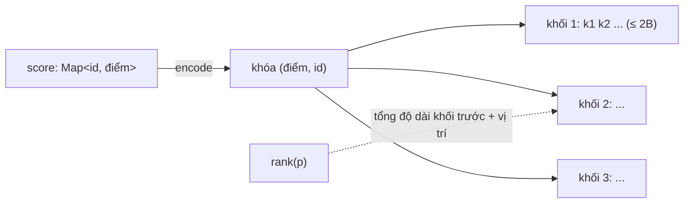
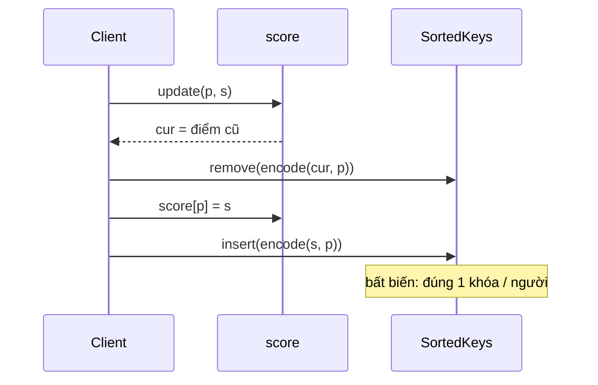

# DESIGN · RankBoard (mẫu theo khung 7 bước)

> Đề mơ hồ: *"Game cần bảng xếp hạng tuần, hiện hạng của người chơi và top 100."*

## 1. API & ngữ nghĩa
| Câu hỏi | Chốt |
|---|---|
| `update` ghi đè hay cộng? | **Ghi đè** (đạt kết quả mới = điểm mới) |
| Hòa điểm | id nhỏ hơn đứng trước ⇒ thứ tự **toàn phần**, `rank` duy nhất |
| `rank` của người lạ | `−1` |
| `top(k)` khi `k` > số người | trả hết; `k = 0` ⇒ `[]` |
| Kiểu hạng | toàn phần (không dense, không competition) |
| Điểm / id | `0 ≤ điểm ≤ 10⁹`, `id ≤ 10⁵` |

## 2. Tải & ràng buộc
- `n ≤ 10⁵`–`10⁶` người, `update` liên tục; đọc `rank` nhiều hơn `top`.
- `top(k)` với `k ≤ 100`: nhỏ nên O(k) là đủ.
- Mục tiêu: `update`, `rank` ≤ O(√n); `top` O(k + n/B).

## 3. Bất biến
1. `score` chứa đúng các người đã `update`; mỗi người có **một** khóa trong `ranks`: `key = (10⁹ − điểm) · 2¹⁷ + id`.
2. Khóa nhỏ hơn ⇒ hạng cao hơn. Vì `id` nằm trong khóa nên không có hai khóa bằng nhau.
3. Hạng của người `p` = (số khóa nhỏ hơn `key(p)`) + 1.
4. `ranks`: các khối khác rỗng, mỗi khối tăng dần, độ dài ≤ 2B.

## 4. Ghép cấu trúc

`update` trên người đã có:

| Phương án | Vì sao không / khi nào |
|---|---|
| Heap | không có `rank` hiệu quả |
| Sort lại mỗi lần | O(n log n) / truy vấn |
| Fenwick theo điểm | điểm tới 10⁹ ⇒ phải nén tọa độ (offline); không hợp stream |
| Skip list có span / cây cân bằng | O(log n), chuẩn; xem D09 (CAP dùng cho ZSET) |
| **Danh sách chia khối** (chọn) | tự cài ngắn, đủ nhanh ở n ≤ 10⁶ |

## 5. Bảng độ phức tạp
| Thao tác | Time | Ghi chú |
|---|---|---|
| `update` | O(B + n/B) = O(√n) | remove + insert: bsearch khối O(log), splice O(B) |
| `rank` | O(n/B + log B) | cộng độ dài khối trước + bsearch |
| `top(k)` | O(k + n/B) | duyệt khối đầu |
| Space | O(n) | |

## 6. Cài đặt & stress test
- `solutions.ts` → `SortedKeys` + `RankBoard`; brute `NaiveRankBoard` (sort mỗi lần).
- Stress `n ≤ 30` không bao giờ chạm đường **tách khối** (cần > 1 024 phần tử) ⇒ thêm 2 case lớn không `expected`: 6 000 thao tác `RankBoard` và 3 000 người chơi + reset gần hết cho `Leaderboard`. Đã thử phá `splice(bi + 1, …)` thành `splice(bi, …)`: cả hai case lớn bị bắt (stress nhỏ thì không).
- Bản đếm O(n) cho `rank` và sort cho `top` bị Perf bắt (chạy quá 1 200 ms trong khi giới hạn 400 ms).
- `node tools/bench.ts lessons/D06-leaderboard 02 --src solutions --scales s,m,l`:

| n | median | số mũ | heap |
|---|---|---|---|
| 10³ | 0.42 ms | – | 1.4 MB |
| 10⁵ | 146 ms | 1.27 | 17.5 MB |
| 10⁶ | 804 ms | 0.74 | 100.8 MB |

(Với `n = 10⁶` thao tác nhưng chỉ 50 000 id khác nhau: kích thước bảng bị chặn nên chi phí mỗi thao tác không tăng thêm; số mũ < 1 là hiệu ứng khởi động của JIT ở scale nhỏ.)

## 7. Đánh đổi & mở rộng
- **×10 dữ liệu (10⁶ người):** `n/B` ≈ 2 000 khối ⇒ `rank` cộng 2 000 số. Cải thiện: giữ mảng cộng dồn kích thước khối (Fenwick trên số khối) ⇒ O(log) cho `rank`; hoặc đổi sang skip list.
- **Hạng khác kiểu:** competition/dense cần đếm điểm khác nhau; thêm cấu trúc đếm theo điểm.
- **Đa luồng / nhiều instance:** bảng xếp hạng toàn cục thường nằm ở Redis `ZADD/ZRANK/ZREVRANGE` (skip list); nhiều instance không chia sẻ bộ nhớ.
- **Bảng xếp hạng cực lớn:** hạng chính xác chỉ cần cho top đầu; phần dưới có thể xấp xỉ bằng phân vị (t-digest, histogram theo điểm).
- **Nút thắt khi ghi ×10:** `splice` trong khối; giảm B hoặc dùng typed array.
- **Thư viện thật:** Redis ZSET, Java `TreeMap` + order-statistic tree (không có sẵn), PostgreSQL `RANK() OVER (ORDER BY score DESC)`.
