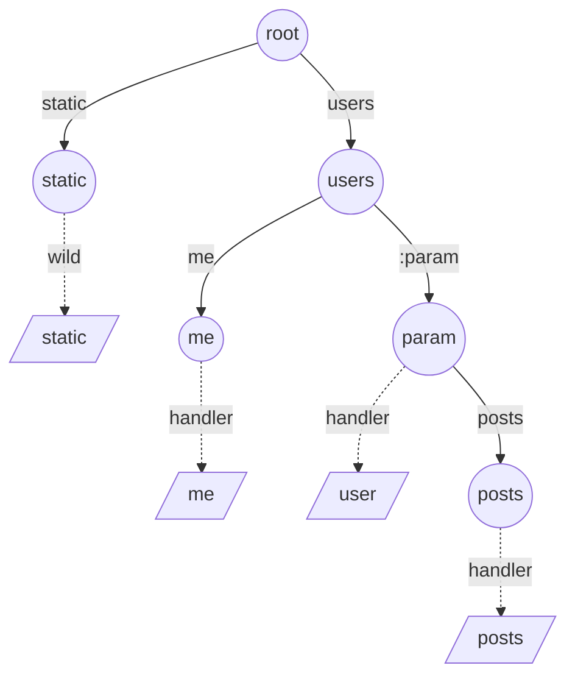
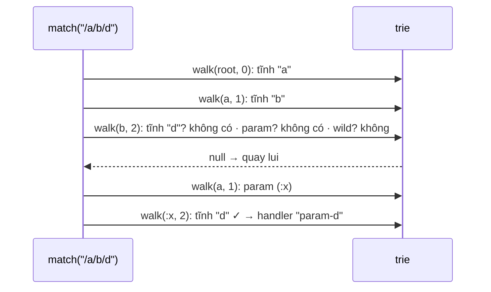

# DESIGN · Router API gateway (mẫu theo khung 7 bước)

> Đề mơ hồ: *"Gateway cần chọn đúng service theo URL; route mới đăng ký động; route cụ thể phải thắng route chung."*

## 1. API & ngữ nghĩa
| Câu hỏi | Chốt |
|---|---|
| Chữ ký | `add(pattern, handler)`, `match(path) → handler | null` |
| Loại đoạn | tĩnh, `:param` (1 đoạn), `*` (≥ 1 đoạn, chỉ cuối) |
| Ưu tiên | tại đoạn đầu tiên khác nhau: tĩnh > tham số > wildcard |
| Quay lui? | **Có** — ưu tiên theo từng đoạn từ trái sang phải, nhưng nhánh phải khớp *toàn* path |
| Trùng hình dạng | route sau ghi đè handler |
| Không khớp | `null` |
| Method HTTP, query string, tham số trả về | ngoài phạm vi (mở rộng ở bài thực hành) |

## 2. Tải & ràng buộc
- `10⁴`–`10⁵` route, nhưng `match` là đường nóng: `10⁵`–`10⁶` request/s ⇒ `match` không phụ thuộc số route.
- Route đăng ký ít, đọc nhiều ⇒ ưu tiên chi phí `match`, `add` có thể đắt hơn.
- Path ngắn (≤ 10 đoạn).

## 3. Bất biến
1. Mỗi mẫu tương ứng đúng một đường đi từ gốc; hai mẫu cùng hình dạng dùng chung đường đi (mọi `:tên` đi vào cùng nhánh `param`).
2. `handler` của nút = handler của mẫu kết thúc **đúng** tại nút (không có wildcard); `wild` = handler của mẫu `…/*` kết thúc tại nút.
3. `wild` chỉ được dùng khi còn **≥ 1** đoạn chưa khớp.
4. Duyệt `walk(node, i)` thử theo thứ tự: nhánh tĩnh → nhánh tham số → `wild`; trả giá trị khớp đầu tiên ⇒ đó là mẫu nhỏ nhất theo vector ưu tiên.

## 4. Ghép cấu trúc

| Phương án | Nhận xét |
|---|---|
| Quét tuyến tính + RegExp | O(số route) mỗi request |
| Hash map theo path đầy đủ | chỉ khớp route hoàn toàn tĩnh |
| **Trie theo đoạn** (chọn) | tìm kiếm tỉ lệ độ dài path |
| Radix tree (nén đường đi) | tiết kiệm bộ nhớ, nhanh hơn (Fastify, httprouter) |

## 5. Bảng độ phức tạp
| Thao tác | Time | Space |
|---|---|---|
| `add` | O(L) | O(L) cho mẫu mới |
| `match` | O(L) thường gặp | – |
| `match` xấu nhất | mỗi nút trie thăm tối đa 1 lần (mỗi nút ứng với đúng một chuỗi lựa chọn) ⇒ O(kích thước trie), thực tế không xảy ra với path ≤ 10 đoạn | – |

## 6. Cài đặt & stress test
- `solutions.ts` → `Router` (DFS có quay lui); brute `NaiveRouter` thử mọi mẫu và chọn mẫu nhỏ nhất theo vector ưu tiên (tĩnh 0 < param 1 < wild 2) — cài đặt *độc lập* với trie, nên stress kiểm chứng cả quy tắc ưu tiên.
- Stress: 300 chuỗi `add`/`match` ngẫu nhiên trên bảng chữ {a, b, c} (rất nhiều va chạm và quay lui).
- Bản quét tuyến tính (brute) trượt Perf: ~29 s cho `10⁵` thao tác (đã đo) khi giới hạn hiệu lực là 2,1 s; ref ~54 ms.
- `node tools/bench.ts lessons/D07-router-filesystem 01 --src solutions --scales s,m,l`:

| n | median | số mũ | heap |
|---|---|---|---|
| 10³ | 0.26 ms | – | 0.5 MB |
| 10⁵ | 58.0 ms | 1.17 | 24.8 MB |
| 10⁶ | 1459 ms | 1.40 | 106.9 MB |

Số mũ 1.4 ở `10⁶` cao hơn lý thuyết (trie lớn hơn bộ nhớ đệm CPU, 40% thao tác là `add` ⇒ ~4·10⁵ route); mỗi `match` vẫn là hằng số theo đoạn.

## 7. Đánh đổi & mở rộng
- **×10 route:** mỗi nút có `Map` + object ⇒ RAM lớn. Nén thành radix tree, hoặc băm đoạn thành số nguyên và lưu nút trong typed array.
- **Trả tham số:** `match` nên trả `{ handler, params }` — thu thập giá trị tại các nhánh `param` trên đường quay lui (đẩy vào stack, pop khi quay lui).
- **Method + host:** cây riêng cho mỗi method; hoặc thêm method làm đoạn đầu tiên.
- **Đăng ký động / hot reload:** tạo trie mới rồi hoán đổi tham chiếu nguyên tử (immutable snapshot) để request đang chạy không bao giờ thấy trie dở dang.
- **Đa luồng / nhiều instance:** trie bất biến sau khi dựng ⇒ đọc song song an toàn; mỗi instance dựng từ cùng cấu hình.
- **Thư viện thật:** Express (`path-to-regexp`, quét tuyến tính), Fastify `find-my-way` (radix tree), Go `httprouter`, Gin; NGINX `location` ưu tiên tiền tố dài nhất.
