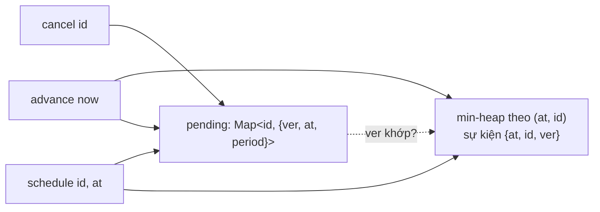
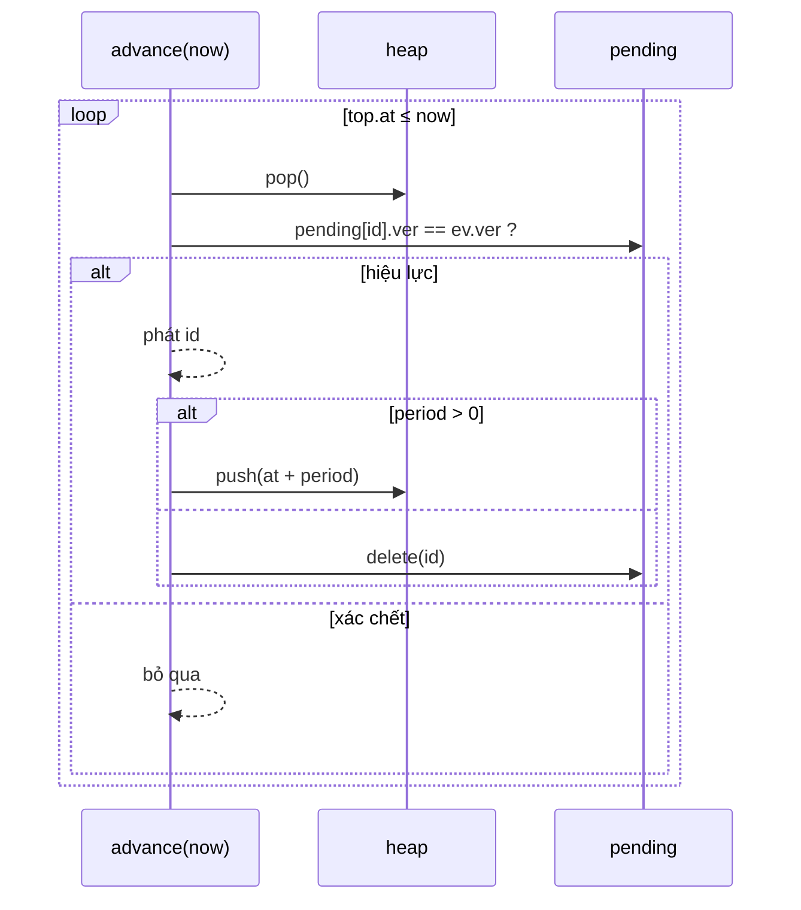

# DESIGN · TaskScheduler (mẫu theo khung 7 bước)

> Đề mơ hồ: *"Cần chạy việc nền theo giờ, hủy được, có việc lặp lại, và không để tiêu hết RAM."*

## 1. API & ngữ nghĩa
| Câu hỏi | Chốt |
|---|---|
| Đồng hồ | không dùng `Date.now()`; caller gọi `advance(now)` (tất định, dễ test) |
| Lên lịch lại cùng `id` | **thay thế** lịch cũ (một id có tối đa một lịch) |
| Việc một lần sau khi chạy | bị xóa |
| Việc lặp | `at, at+p, at+2p, …`; `advance` phát đủ mọi lần ≤ `now` |
| Hòa thời điểm | `id` nhỏ trước |
| `cancel` | trả `true` nếu id đang chờ; hủy cả việc lặp |
| `at` ở quá khứ | hợp lệ, chạy ở `advance` kế |
| Ngoài phạm vi | tính đúng thời điểm thực, mất việc khi restart, chạy song song |

## 2. Tải & ràng buộc
- `10⁵`–`10⁶` việc đang chờ; hủy/đổi lịch xảy ra thường xuyên (retry, debounce).
- `advance` gọi thường xuyên nhưng mỗi lần chỉ phát vài việc.
- Mục tiêu: `schedule` O(log n), `cancel` O(1), `advance` O((phát + bỏ) log n).

## 3. Bất biến
1. `pending[id]` (nếu có) là lịch *hiện hành* của id: `{ver, at, period}`.
2. Với mỗi id trong `pending` có **đúng một** sự kiện hiệu lực trong heap: `{at: pending.at, id, ver: pending.ver}`.
3. Sự kiện trong heap mà `pending[id]` không tồn tại hoặc `ver` lệch là **xác chết**; bị bỏ khi nổi lên đỉnh.
4. `heap.size ≤ 2·|pending| + 16` sau mỗi `schedule` (dựng lại khi vượt).
5. Heap sắp theo `(at, id)` ⇒ thứ tự phát xác định.

## 4. Ghép cấu trúc

| Phương án | Nhận xét |
|---|---|
| Danh sách chưa sắp, quét mỗi `advance` | O(n) mỗi lần |
| Mảng sắp + chèn bằng `splice` | `schedule` O(n) |
| Heap + xóa chủ động (heap có chỉ số) | chính xác nhưng nhiều code |
| **Heap + xóa lười + phiên bản** (chọn) | ít code, đủ nhanh |
| Timer wheel | O(1) nhưng độ phân giải cố định, vượt vòng cần xử lý thêm |

## 5. Bảng độ phức tạp
| Thao tác | Time | Ghi chú |
|---|---|---|
| `schedule` / `scheduleEvery` | O(log n) | dựng lại O(n) mỗi khi heap > 2n ⇒ O(1) amortized phần thêm |
| `cancel` | O(1) | chỉ xóa khỏi `pending` |
| `advance` | O((f + s) log n) | f phát, s xác chết bị bỏ |
| Space | O(n) | chặn bởi quy tắc dựng lại |

## 6. Cài đặt & stress test
- `solutions.ts` → `TaskScheduler`; brute `NaiveScheduler` (Map; `advance` sinh mọi lần phát ≤ now rồi sắp) hoàn toàn khác heap.
- Stress: 300 chuỗi ngẫu nhiên (id ≤ 6, thời điểm ≤ 30, chu kỳ 1–12) so với brute, bao gồm lên lịch lại, hủy rồi lên lịch, việc lặp nhảy xa.
- Bản quét tuyến tính (`NaiveScheduler`) bị Perf bắt (chạy quá 3 600 ms khi giới hạn hiệu lực 1 200 ms).
- `node tools/bench.ts lessons/D08-task-scheduler 01 --src solutions --scales s,m,l`:

| n | median | số mũ | heap |
|---|---|---|---|
| 10³ | 0.23 ms | – | 1.0 MB |
| 10⁵ | 18.0 ms | 0.95 | 12.4 MB |
| 10⁶ | 469 ms | 1.41 | 72.9 MB |

## 7. Đánh đổi & mở rộng
- **×10 việc:** mỗi sự kiện là object (`at, id, ver`) ⇒ RAM; dùng typed array song song + heap lưu chỉ số. Hoặc timer wheel nhiều tầng (O(1)).
- **Độ phân giải:** heap cho thời điểm tùy ý (ms, µs); wheel quy về tick.
- **Việc lặp bị trễ:** chọn chính sách *catch-up* (phát đủ — như đề), *skip* (bỏ lần lỡ, giữ nhịp), hoặc *drift* (tính lại từ `now`).
- **Đa luồng / nhiều instance:** nhiều worker cùng lấy việc ⇒ cần khóa hoặc hàng đợi bền vững (Redis ZSET theo `score = at`: `ZRANGEBYSCORE` + `ZREM` nguyên tử; database với `SELECT … FOR UPDATE SKIP LOCKED`).
- **Bền vững:** mất việc khi restart ⇒ ghi lịch vào DB/log; khi khởi động đọc lại và dựng heap.
- **Nút thắt khi ghi ×10:** `Heap.push` O(log n); với hàng triệu timer ngắn hạn, wheel thắng rõ.
- **Thư viện thật:** Linux hrtimer / timer wheel, Kafka `SystemTimer`, Netty `HashedWheelTimer`, Quartz (DB), BullMQ (Redis).
