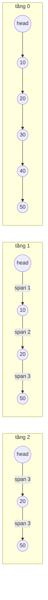

# DESIGN · OrderedMap bằng skip list có span (mẫu theo khung 7 bước)

> Đề mơ hồ: *"Cần tra 'bản ghi gần nhất trước thời điểm T' và 'có bao nhiêu bản ghi trong khoảng' mà không muốn quét tất cả."*

## 1. API & ngữ nghĩa
| Câu hỏi | Chốt |
|---|---|
| Khóa | `int`, không trùng |
| `put` khóa đã có | đè giá trị, không đổi thứ tự/size |
| `get` thiếu | `null` |
| `floorKey(k)` / `ceilingKey(k)` | ≤ k / ≥ k; không có → `null` |
| `rangeCount(lo, hi)` | đếm khóa trong `[lo, hi]` (đóng hai đầu); `lo > hi` → 0 |
| `remove` | trả `true` nếu có xóa |
| Thứ tự duyệt, `firstKey`, `pollFirst` | ngoài phạm vi (dễ thêm: tầng 0 đã sắp) |

## 2. Tải & ràng buộc
- `10⁵`–`10⁶` thao tác, `n` tới `10⁶` khóa; trộn ghi và truy vấn.
- Mọi thao tác cần O(log n) — đặc biệt `rangeCount` không được phụ thuộc số khóa trong khoảng.
- Không cần đồng thời (xem bước 7).

## 3. Bất biến
1. Tầng 0 chứa **mọi** nút theo thứ tự tăng của khóa, không trùng.
2. Một nút chiều cao `h` có mặt ở các tầng `0..h−1`; liên kết tầng `i` của nó trỏ tới nút kế gần nhất có chiều cao > `i`.
3. `span` của liên kết `x → y` ở tầng `i` = (vị trí `y`) − (vị trí `x`) tính ở tầng 0; head có vị trí 0. Với liên kết rỗng, `span = size − vị trí(x)`.
4. `level` = chiều cao lớn nhất đang dùng (co lại khi xóa nút cao nhất).
5. `size` = tổng độ dài tầng 0.

## 4. Ghép cấu trúc

`set(k, v)` — các bước và bất biến:
```mermaid
sequenceDiagram
    participant S as set(k)
    participant L as skip list
    S->>L: findPreds: với mỗi tầng i, update[i] = nút cuối có key < k; rank[i] = vị trí của nó
    alt key đã có
        S->>L: ghi đè giá trị (hết)
    else key mới
        S->>L: h = randomLevel(); nếu h > level: tầng mới nối từ head, span = size
        S->>L: với i < h: nối nút vào sau update[i]; span chia đôi theo (rank[0] − rank[i])
        S->>L: với i ≥ h: update[i].span[i]++ (liên kết vượt qua nút mới)
        S->>L: size++
    end
```
| Phương án | Vì sao không / khi nào |
|---|---|
| `Map` + sort mỗi truy vấn | O(n log n) |
| Mảng sort + binary search | chèn O(n); thắng ở n nhỏ (số đo ở README) |
| Danh sách chia khối | O(√n) |
| Cây đỏ-đen có kích thước cây con | O(log n) nhưng nhiều code xoay/cân bằng |
| **Skip list + span** (chọn) | ~100 dòng, O(log n) kỳ vọng, cùng cấu trúc với Redis ZSET |

## 5. Bảng độ phức tạp
| Thao tác | Time (kỳ vọng) | Ghi chú |
|---|---|---|
| `put`, `remove`, `get` | O(log n) | |
| `floorKey`, `ceilingKey` | O(log n) | |
| `rangeCount` | O(log n) | hai lần tìm hạng |
| `rank`, `at(i)` | O(log n) | dùng span |
| `slice(i, j)` | O(log n + j − i) | dùng cho CAP (`zrange`) |
| Space | O(n) | trung bình 2 con trỏ + 2 span/nút |

Xấu nhất O(n) có thể xảy ra nhưng xác suất giảm theo hàm mũ; chiều cao tối đa 24 đủ cho n ≤ 10⁷.

## 6. Cài đặt & stress test
- `solutions.ts` → `IndexedSkipList<K, V>` (comparator tùy ý, RNG mulberry32 có seed) + `OrderedMap`, `MyCalendar` bọc ngoài.
- Brute `NaiveOrderedMap`: `Map` + quét mọi khóa mỗi truy vấn.
- Stress `n ≤ 30` với khóa trong ±20 **không** đủ để lộ lỗi span ở nhiều tầng ⇒ thêm 2 case lớn: 2 000 khóa tăng dần rồi xóa một nửa, và 4 000 thao tác ngẫu nhiên. Đã thử phá bước `update[i].span[i]++` cho tầng i ≥ h: stress nhỏ vẫn qua, case 4 000 thao tác bị bắt.
- Bản quét O(n) mỗi truy vấn bị Perf bắt (3 969 ms > 1 800 ms hiệu lực).
- `bench` (khóa ±10⁹):

| n | skip list | mảng sort + splice |
|---|---|---|
| 10³ | 0.46 ms | 0.20 ms |
| 10⁵ | 91.8 ms (số mũ 1.15) | 211 ms (số mũ 1.51) |
| 10⁶ | 2 627 ms (1.46) | 19 500 ms (1.97) |

`MyCalendar.book` (4 lần tìm/lệnh): 243 ms ở 10⁵ và 2 692 ms ở 10⁶ lần đặt.

## 7. Đánh đổi & mở rộng
- **Hằng số:** con trỏ trên heap, cache kém hơn mảng; ở n < ~10³ mảng sort thắng. Hệ thống thật dùng mảng cho khối nhỏ (B-tree lá).
- **×10 dữ liệu:** mỗi nút là object + 2 mảng nhỏ ⇒ RAM lớn. Dùng typed array (`keys[]`, `next[level][]` theo chỉ số), `p = 1/4` giảm số con trỏ.
- **Đa luồng:** skip list thân thiện đồng thời (Java `ConcurrentSkipListMap` dùng CAS trên con trỏ, không khóa toàn cục); cây cân bằng khó hơn do xoay.
- **Nhiều instance / bền vững:** Redis `ZSET` (skip list + hash) cung cấp đúng các thao tác này qua mạng; LSM-tree (LevelDB/RocksDB) dùng skip list làm memtable.
- **Nút thắt khi ghi ×10:** cấp phát nút; dùng pool node, hoặc gom ghi theo lô vào mảng rồi trộn (merge) định kỳ.
- **Mở rộng API:** `firstKey/lastKey/pollFirst`, `subMap` duyệt tầng 0, đếm theo hạng `at(i)`, `lowerKey/higherKey` (nghiêm ngặt).
