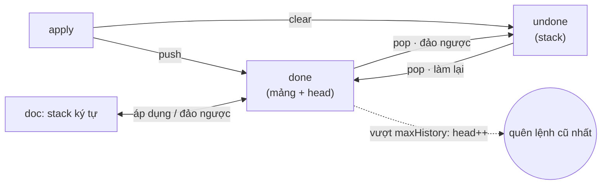
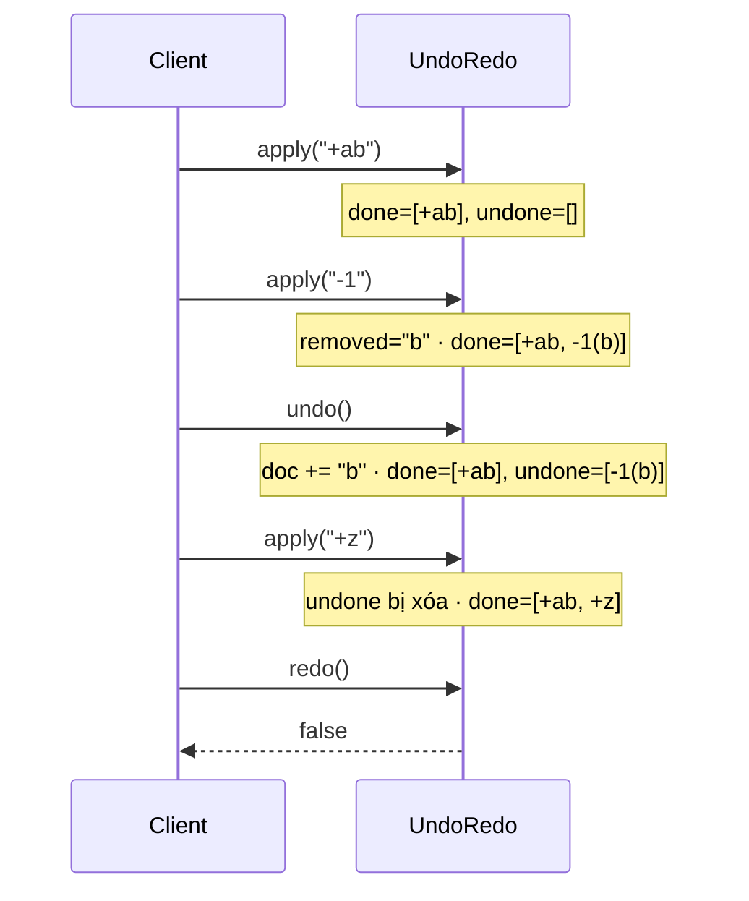

# DESIGN · UndoRedo (mẫu theo khung 7 bước)

> Đề mơ hồ: *"Ứng dụng ghi chú cần Ctrl+Z / Ctrl+Y, nhưng đừng giữ lịch sử vô hạn."*

## 1. API & ngữ nghĩa
| Câu hỏi | Chốt |
|---|---|
| Lệnh | `+text` (thêm vào cuối), `-k` (xóa ≤ k ký tự cuối) |
| `undo`/`redo` trả gì | `boolean`: có thực hiện được không |
| `apply` mới sau `undo` | **xóa** toàn bộ redo |
| Giới hạn | tối đa `maxHistory` lệnh có thể undo; quên lệnh **cũ nhất** khi vượt |
| `-k` với `k` > độ dài | xóa hết, vẫn tính là một lệnh |
| `state()` | chuỗi hiện tại |
| Ngoài phạm vi | nhóm nhiều lệnh thành một bước undo, con trỏ, đa người dùng |

## 2. Tải & ràng buộc
- `10⁵` lệnh, `maxHistory` tới `10⁵`; văn bản tới ~10⁶ ký tự.
- `apply/undo/redo` là đường nóng (mỗi phím); `state()` hiếm hơn nhưng có thể gọi nhiều lần.
- Bộ nhớ: lịch sử chặn ở `maxHistory`.

## 3. Bất biến
1. Áp dụng `done` (theo thứ tự) lên văn bản đã "đóng băng" trước lệnh cũ nhất còn nhớ cho ra đúng văn bản hiện tại.
2. `|done| ≤ maxHistory` và `|done| + |undone| ≤ maxHistory` (undo chỉ chuyển lệnh qua lại).
3. Mỗi lệnh lưu đủ để đảo ngược: `+text` lưu `text`; `-k` lưu **phần đã xóa thực sự**.
4. `undone` rỗng ngay sau mỗi `apply`.

## 4. Ghép cấu trúc

| Phương án | Nhận xét |
|---|---|
| Command (chọn) | bộ nhớ ∝ kích thước lệnh; cần cài đảo ngược cho từng loại lệnh |
| Memento (lưu cả văn bản mỗi lệnh) | đơn giản; O(độ dài) bộ nhớ/lệnh nếu không chia sẻ cấu trúc |
| Chạy lại toàn bộ lịch sử khi cần `state()` | O(lịch sử) mỗi lần |
| Persistent (rope/piece table bất biến) | undo O(1) ở mọi quy mô; nhiều code |

## 5. Bảng độ phức tạp
| Thao tác | Time | Space |
|---|---|---|
| `apply("+t")` | O(|t|) | + O(|t|) lịch sử |
| `apply("-k")` | O(min(k, len)) | + O(phần đã xóa) |
| `undo`, `redo` | O(độ dài lệnh) | – |
| bỏ lệnh cũ nhất | O(1) amortized (`head++`, cắt khi `head` > một nửa) | – |
| `state()` | O(độ dài văn bản) | O(độ dài) chuỗi trả về |

## 6. Cài đặt & stress test
- `solutions.ts` → `UndoRedo` (doc là stack ký tự, `done` mảng + `head`, `undone` stack).
- Brute `NaiveUndoRedo`: lưu danh sách lệnh, `state()` chạy lại tất cả — cài đặt hoàn toàn khác nên stress kiểm chứng cả quy tắc giới hạn lịch sử.
- Stress: 300 chuỗi `apply/undo/redo/state` ngẫu nhiên với `maxHistory` 1–4 (giới hạn bị chạm liên tục).
- Bản chạy-lại-lịch-sử bị Perf bắt (8 271 ms so với giới hạn hiệu lực 2 100 ms ở hệ số 3; ref ≈ 105 ms).
- `node tools/bench.ts lessons/D10-text-buffer-undo 02 --src solutions --scales s,m,l`:

| n | median | số mũ | heap |
|---|---|---|---|
| 10³ | 0.33 ms | – | 0.1 MB |
| 10⁵ | 92.8 ms | 1.22 | 44.1 MB |
| 10⁶ | 3 491 ms | 1.58 | 281.6 MB |

Số mũ 1.58 ở bước cuối: `state()` là O(độ dài văn bản) và văn bản dài thêm khi `n` tăng (8% thao tác là `state()`). Đây là chi phí đúng theo bảng ở bước 5, không phải lỗi; muốn `state()` O(1) cần giữ sẵn chuỗi (bất biến/rope) thay vì stack ký tự.

## 7. Đánh đổi & mở rộng
- **Undo theo nhóm:** gõ liên tục được gộp (debounce theo thời gian hoặc ranh giới từ) thành một lệnh `+text` dài — giảm bộ nhớ và số lần phải bấm Ctrl+Z.
- **×10 dữ liệu:** `string[]` một ký tự/ô tốn ~vài chục byte mỗi ký tự trong JS; dùng `Uint16Array` có tăng trưởng gấp đôi, hoặc rope.
- **Lịch sử rất dài:** bỏ lệnh cũ theo số lượng (như đề) hoặc theo dung lượng; lưu "điểm kiểm tra" (checkpoint) văn bản để undo xa không phải đảo từng lệnh.
- **Đa người dùng (cộng tác):** undo cục bộ phải *đảo ngược ý định* chứ không phải trạng thái ⇒ OT / CRDT (Google Docs, Figma).
- **Bền vững:** ghi lệnh vào log (event sourcing); khôi phục = phát lại log.
- **Thư viện thật:** CodeMirror/ProseMirror (history plugin với giới hạn `depth` và gộp theo `newGroupDelay`), VS Code piece table, Emacs undo tree.
