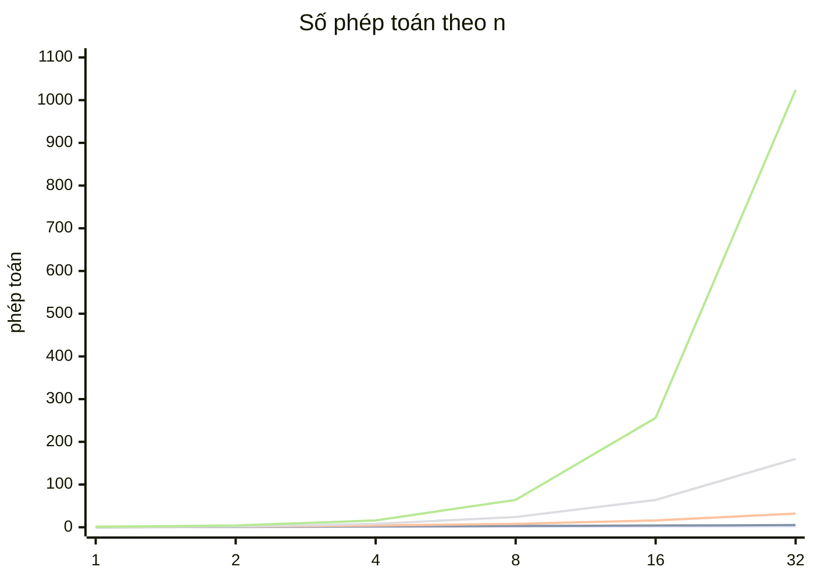

# F01 · Big-O & phân tích độ phức tạp

## Sau buổi này bạn sẽ
- Đếm được số phép toán của một đoạn code và quy về Big-O.
- Nhìn ràng buộc `n` trong đề là biết lời giải được phép chậm tới mức nào.
- Nhận ra **vòng lặp trá hình**: `includes`, `indexOf`, `shift`, `splice`, `slice`, spread, `Object.keys` bên trong vòng lặp.
- Dùng `bench` để kiểm chứng Big-O bằng số đo.

## 1. Big-O là gì

Big-O mô tả **thời gian (hoặc bộ nhớ) tăng thế nào khi n tăng**, bỏ qua hằng số và số hạng nhỏ.

```
3n² + 100n + 7   →   O(n²)       (n lớn thì n² lấn át mọi thứ)
n/2              →   O(n)
log₂ n + 5       →   O(log n)
```


(từ dưới lên: O(1), O(log n), O(n), O(n log n), O(n²))

| Big-O | Tên | Ví dụ | n = 10⁶ thì ≈ |
|---|---|---|---|
| O(1) | hằng số | truy cập `a[i]`, `map.get` | 1 phép |
| O(log n) | logarit | binary search, chia đôi liên tục | 20 phép |
| O(n) | tuyến tính | duyệt mảng 1 lần | 10⁶ |
| O(n log n) | | sort | 2·10⁷ |
| O(n²) | bình phương | 2 vòng lặp lồng | 10¹² ❌ |
| O(2ⁿ) | hàm mũ | thử mọi tập con | ❌ từ n ≈ 30 |
| O(n!) | giai thừa | thử mọi hoán vị | ❌ từ n ≈ 11 |

## 2. Cách đếm

**Vòng lặp tuần tự → cộng; lồng nhau → nhân.**

```ts
for (let i = 0; i < n; i++) {}            // n
for (let i = 0; i < n; i++) {}            // + n        → O(n)

for (let i = 0; i < n; i++)
  for (let j = i + 1; j < n; j++) {}      // n(n-1)/2   → O(n²)

for (let i = 1; i < n; i *= 2) {}         // log₂ n     → O(log n)
```

**Biến chạy nhân/chia đôi → log.** **Biến không reset giữa các vòng ngoài → cộng chứ không nhân** (two pointers):
```ts
let j = 0;
for (let i = 0; i < n; i++) {
  while (j < n && a[j] < a[i]) j++;       // j chỉ tăng, tổng cộng ≤ n lần → cả đoạn O(n)
}
```

**Đệ quy:** vẽ cây gọi hàm. Số node × chi phí mỗi node.
```
fib(5)                         mỗi node gọi 2 node con, sâu n
├── fib(4)                     → ~2ⁿ node → O(2ⁿ)
│   ├── fib(3) ...
└── fib(3) ...
```

## 3. Vòng lặp trá hình trong JS

Một dòng code **không** có nghĩa là O(1):

| Thao tác | Chi phí | Ghi chú |
|---|---|---|
| `arr.push(x)`, `arr.pop()` | O(1) amortized | |
| `arr.shift()`, `arr.unshift(x)` | **O(n)** | dịch toàn bộ phần tử |
| `arr.splice(i, 1)` | **O(n)** | |
| `arr.includes(x)`, `indexOf`, `find` | **O(n)** | quét tuyến tính |
| `arr.slice()`, `[...arr]`, `concat` | **O(n)** | tạo mảng mới |
| `arr.sort()` | O(n log n) | |
| `Object.keys(obj)` | **O(số key)** | |
| `set.has`, `map.get/set` | O(1) trung bình | |
| `str.length`, `str[i]` | O(1) | |
| `str.slice`, `split`, `str1 + str2` | O(độ dài) | V8 tối ưu `+=` bằng rope nhưng đừng dựa vào |

```ts
// ❌ O(n²): includes quét mảng mỗi vòng
const out: number[] = [];
for (const x of nums) if (!out.includes(x)) out.push(x);

// ✅ O(n): Set tra cứu O(1)
const seen = new Set<number>();
for (const x of nums) if (!seen.has(x)) { seen.add(x); out.push(x); }
```

## 4. Ràng buộc → độ phức tạp cho phép

Máy chạy JS làm được khoảng **10⁸ phép đơn giản / giây**. Giới hạn thường 1 giây.

| n trong đề | Được phép | Gợi ý thuật toán |
|---|---|---|
| ≤ 10 | O(n!) | hoán vị |
| ≤ 20 | O(2ⁿ) | tập con, bitmask |
| ≤ 500 | O(n³) | 3 vòng lặp, Floyd |
| ≤ 5 000 | O(n²) | 2 vòng lặp, DP 2 chiều |
| ≤ 10⁶ | O(n log n) | sort, heap, binary search |
| ≤ 10⁸ | O(n) | một lượt |
| lớn hơn | O(log n), O(1) | công thức, binary search |

## 5. Space complexity
Đếm bộ nhớ **thêm** ngoài input: mảng phụ, Map, **và call stack của đệ quy** (đệ quy sâu n tầng = O(n) bộ nhớ).

## 6. Best / average / worst & amortized
- Quick sort: trung bình O(n log n), xấu nhất O(n²). `Map.get`: trung bình O(1), xấu nhất O(n) (va chạm hash).
- **Amortized**: `push` thỉnh thoảng phải copy mảng sang vùng lớn gấp đôi (O(n)), nhưng chia đều cho n lần push thì mỗi lần O(1).

## 7. Bẫy
1. Chỉ nhìn số vòng `for` mà quên hàm có sẵn bên trong (bảng mục 3).
2. Thấy 2 vòng lồng là kết luận O(n²) — two pointers/sliding window là O(n).
3. Quên chi phí sort: "duyệt 1 lần" nhưng có `sort` đầu hàm → O(n log n).
4. `%` trong JS giữ dấu số bị chia: `-7 % 3 === -1`. Muốn số dư không âm: `((x % k) + k) % k`.
5. Bộ nhớ đệ quy: hàm đệ quy không tạo mảng nào vẫn tốn O(độ sâu).
