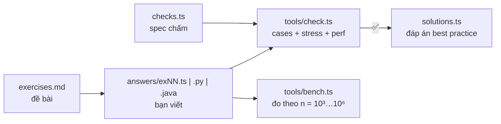

# S00 · Môi trường & công cụ

## Sau buổi này bạn sẽ
- Chọn được ngôn ngữ làm bài (TypeScript / Python / Java) và tạo file khung.
- Biết quy trình một bài: đọc đề → viết vào `answers/exNN.*` → `check` → xem đáp án mẫu.
- Dùng `bench` để **đo** Big-O thay vì đoán.
- Debug bằng in ra màn hình và debugger của IDE.

## 1. Bức tranh tổng thể



Bộ chấm viết bằng TS: nó sinh input, tính đáp án kỳ vọng, rồi chạy bài của bạn (TS chạy trực tiếp; Python/Java chạy qua runner trong `tools/runners/`) và so kết quả.

| Lệnh | Tác dụng |
|---|---|
| `node tools/scaffold.ts lessons/F04-hashing --lang py` | Tạo file khung `answers/exNN.py` có sẵn chữ ký hàm (không ghi đè file đã có). Bỏ `--lang` thì dùng ngôn ngữ trong `dsa.config.json` |
| `node tools/check.ts lessons/F04-hashing 03` | Chấm bài 03. Nếu có nhiều file `ex03.*` thì chấm file **sửa gần nhất**; muốn chỉ định: `--lang java` |
| `node tools/check.ts lessons/F04-hashing` | Chấm cả module |
| `node tools/check.ts lessons/F04-hashing 03 --src solutions` | Chạy đáp án mẫu (TS) để so sánh |
| `node tools/bench.ts lessons/F04-hashing 03` | Đo bài của bạn ở n = 10³, 10⁵, 10⁶ |
| `npx tsc --noEmit` | Kiểm tra kiểu TypeScript |

> **Quy ước tự giác:** chỉ mở `solutions.ts` **sau khi** `check` báo ✅ (hoặc sau khi đã xin H3 mà vẫn bí). `checks.ts` cũng chứa lời giải ngây thơ — đừng đọc trước.

## 2. Đề viết chữ ký kiểu Java — khung tự sinh cho từng ngôn ngữ

Đề ghi: `long countPairs(int[] nums, int k)`. Scaffold sinh ra:

```ts
// TypeScript — answers/ex02.ts
export function countPairs(nums: number[], k: number): number { ... }
```
```python
# Python — answers/ex02.py   (tên hàm/biến chuyển sang snake_case)
def count_pairs(nums: list[int], k: int) -> int: ...
```
```java
// Java — answers/ex02.java   (KHÔNG viết "public class", file tên ex02.java)
class Solution {
    public long countPairs(int[] nums, int k) { ... }
}
```

Kiểu trong đề còn là lời nhắc cho Java: thấy `long` nghĩa là kết quả có thể vượt 2³¹ − 1 ≈ 2.1 tỉ.

## 3. `check` chấm những gì?

```
== ex02 · Đếm cặp có tổng bằng k (countPairs) · Python
Cases    : ✅ 7/7                         ← ví dụ trong đề + edge case (rỗng, 1 phần tử, trùng, âm, tràn số)
Stress   : ✅ 300/300 (seed 42, n ≤ 30, so với ref)   ← 300 input ngẫu nhiên nhỏ
Perf     : ✅ n=1e5 · 24.2 ms (giới hạn 2500 ms)      ← input lớn, có giới hạn thời gian
Kết quả  : ✅ ĐÚNG
```

Khi sai, `check` in **input nhỏ nhất** làm bài sai. Việc của bạn: **dry-run bằng tay** đúng input đó.

```
Cases    : ❌ sai ở case cố định
  input   : [[1,5,3,3,3],6]
  bài làm : 7
  kỳ vọng : 4
```

Giới hạn thời gian Python = 10 × TS, Java = 3 × TS. Thuật toán đúng Big-O vẫn qua thoải mái; sai Big-O thì trượt ở cả 3 ngôn ngữ.

## 4. Đo Big-O bằng `bench`

```
| scale | n   | median ms | ×thời gian | số mũ |
| s     | 1e3 | 0.9       | –          | –     |
| m     | 1e5 | 8900      | ×9888      | 2.00  |   ← n ×100 mà thời gian ×10 000 → O(n²)
```

**Số mũ** = log(t₂/t₁) / log(n₂/n₁): ≈1 → O(n), hơi trên 1 → O(n log n), ≈2 → O(n²). Ở n nhỏ (< 1 ms) số đo nhiễu, đừng tin.

## 5. Tự chạy thử & debug

| | Chạy thử nhanh | Debug |
|---|---|---|
| TS | thêm `if (import.meta.main) console.log(countPairs([1,5,3,3,3], 6));` rồi `node lessons/S00-setup/answers/ex02.ts` | VS Code: breakpoint + `F5` → Node.js |
| Python | thêm `if __name__ == "__main__": print(count_pairs([1,5,3,3,3], 6))` rồi `python lessons/S00-setup/answers/ex02.py` | VS Code / PyCharm debugger, hoặc `breakpoint()` |
| Java | thêm `public static void main(String[] a) { System.out.println(new Solution().countPairs(new int[]{1,5,3,3,3}, 6)); }` rồi `java lessons/S00-setup/answers/ex02.java` (bài có ListNode/TreeNode: `java -cp tools/runners/java/out ...`) | IntelliJ / VS Code |

Các khối chạy thử trên **không** ảnh hưởng `check`, có thể để nguyên. `print`/`console.log` trong bài cũng không làm hỏng việc chấm.

Debug cấu trúc: TS `printTree(buildTree([...]))`, `listToArray(head)` trong `tools/lib.ts`; Python `print_tree`, `list_to_array` trong `dsa`.

## 6. Bẫy sẽ gặp suốt lộ trình

| Ngôn ngữ | Bẫy | Đúng |
|---|---|---|
| TS | `[10, 9, 1].sort()` → `[1, 10, 9]` (so chuỗi) | `.sort((a, b) => a - b)` |
| TS | `queue.shift()` là O(n) | con trỏ `head++` |
| TS | `Array(3).fill([])` — 3 hàng dùng chung 1 mảng | `Array.from({ length: 3 }, () => [])` |
| TS | số nguyên an toàn chỉ tới 2⁵³; bitwise ép về int32 | `BigInt`, `>>>` |
| Python | `queue.pop(0)` là O(n) | `collections.deque.popleft()` |
| Python | `[[0] * m] * n` — n hàng dùng chung | `[[0] * m for _ in range(n)]` |
| Python | chậm ~30× so với TS/Java | ưu tiên built-in (`sum`, `sorted`, `Counter`) trong vòng lặp nóng |
| Java | `int` tràn ở ~2.1 × 10⁹ | `long`, `Math.addExact` để phát hiện |
| Java | `Integer a == Integer b` sai khi > 127 | `.equals()` hoặc unbox |
| Cả 3 | đệ quy sâu ~10⁴ tầng → tràn stack | stack tự quản |
